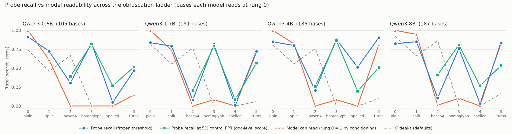

# EXPERIMENTS

Every row records the git SHA, model id and revision, layer, data hash and seed (section 8 of docs/DESIGN.md).

## Dataset licenses

| Dataset | License | Allowed use? | Notes |
| --- | --- | --- | --- |
| ai4privacy/pii-masking-300k | `other` (custom LICENSE.md) | **Skipped (user decision 2026-11-15)** | Not used for training: PII stays synthetic, so the released weights are trained on synthetic data only. A later eval-only sample is possible, after contacting the authors. Card checked 2026-11-15: "Academic use is encouraged with proper citation provided it follows similar license terms", commercial entities must contact the authors, and "Terms apply". Not downloaded. |
| ai4privacy/pii-masking-400k | `other` (custom LICENSE.md) | **Skipped (user decision 2026-11-15)** | Same terms as 300k. A converter and label map are ready (`maps/ai4privacy.yaml`), but no data has been downloaded. |
| ai4privacy/open-pii-masking-500k-ai4privacy | `other`, with `license_name: cc-by-4.0` | **Skipped (user decision 2026-11-15)** | The card says use and distribution are subject to the Llama 3.1/3.3 Community License (a "Built with Llama" attribution, license inclusion, the Acceptable Use Policy), and that use beyond the permitted scope may need written permission. Not downloaded. |
| codeparrot/github-code-clean | Card tag `apache-2.0`, but every file keeps its own repo license (per-file `license` column; the parent `codeparrot/github-code` card is `license: other`) | **Yes, filtered (user decision 2026-11-16)** | Training negatives only. Only files whose per-file license is mit, apache-2.0, bsd-3-clause, bsd-2-clause, isc, cc0-1.0 or unlicense are used (164,478 of 253,850 files in shards 00000 and 00001). Stored locally under `$CASTELLAN_ROOT/corpora/github-code-clean`, never in git. Filtered by gitleaks and rules (a) to (g) in `scripts/mine_negatives.py`. |
| venv package configs | Each package's own license metadata | **Yes, permissive only** | 57 YAML/JSON/TOML/INI/.cfg files from packages whose license metadata is MIT, Apache, BSD, ISC, PSF, CC0, Unlicense, 0BSD or zlib, and not GPL. |

## Baseline configurations

### Gitleaks
Version 8.30.1 (brew) with the default config and default flags, which include `--max-decode-depth 5`. The wrapper is `src/castellan/baselines/gitleaks.py`. It is non-scoring: every finding has score 1.0, and a document is flagged when it has any finding. A `--max-decode-depth 0` ablation is planned for after the M2 freeze.

### Presidio + UK NINO
presidio-analyzer 2.2.362 with spaCy `en_core_web_lg` 3.8.0, language `en`, and no score threshold. The setup is the stock `AnalyzerEngine` registry **plus `UkNinoRecognizer`**, which ships with presidio but is not registered by default. It was enabled on 2026-11-15 at the user's request. Span edges are trimmed of whitespace (the stock UK_NINO regex can include a leading space). Trimming changes no detection decision. Presidio entity types that do not map onto our labels are dropped. Every eval report stores this list under `detectors.presidio.info.recognizers`.

| Recognizer | Presidio entities | Our labels |
| --- | --- | --- |
| CreditCardRecognizer | CREDIT_CARD | CARD |
| CryptoRecognizer | CRYPTO | SECRET_GENERIC |
| DateRecognizer | DATE_TIME | dropped |
| EmailRecognizer | EMAIL_ADDRESS | EMAIL |
| IbanRecognizer | IBAN_CODE | CARD |
| IpRecognizer | IP_ADDRESS | IP_ADDRESS |
| MacAddressRecognizer | MAC_ADDRESS | dropped |
| MedicalLicenseRecognizer | MEDICAL_LICENSE | GOV_ID |
| NhsRecognizer | UK_NHS | GOV_ID |
| PhoneRecognizer | PHONE_NUMBER | PHONE |
| SpacyRecognizer | AGE, PERSON, PHONE_NUMBER, LOCATION, ORGANIZATION, DATE_TIME, EMAIL, NRP, ID | PERSON, ADDRESS (from LOCATION), PHONE. AGE, ORGANIZATION, DATE_TIME, NRP, EMAIL and ID are dropped. |
| UkNinoRecognizer (added) | UK_NINO | GOV_ID |
| UrlRecognizer | URL | dropped |
| UsBankRecognizer | US_BANK_NUMBER | CARD |
| UsItinRecognizer | US_ITIN | GOV_ID |
| UsLicenseRecognizer | US_DRIVER_LICENSE | GOV_ID |
| UsPassportRecognizer | US_PASSPORT | GOV_ID |
| UsSsnRecognizer | US_SSN | GOV_ID |

### Matched operating points
For each non-scoring baseline, `castellan eval` also reports `comparisons.<baseline>` from `evaluate.compare_operating_points`. That block holds the baseline's document-level recall and FPR, the probe's recall at the baseline's FPR, and the probe's FPR at the baseline's recall, per category and per rung.

## Baselines on the frozen sets (2026-11-16)

Run with `scripts/run_baselines.py` at git e784a1e. Code commit e243fb6 holds the runner, and the frozen evaluate.py hash is `1d04ca80...`. Reports and value-free predictions are in `runs/baselines/` (not committed). Three configurations:
- gitleaks 8.30.1, default (`--max-decode-depth 5`)
- gitleaks_d0 (`--max-decode-depth 0`)
- Presidio + UK NINO: presidio-analyzer 2.2.362 with en_core_web_lg 3.8.0, stock registry plus UkNinoRecognizer

All metrics are category level as defined in evaluate.py. Doc metrics treat a finding as the document decision (non-scoring baselines).

### Gate and other non-ladder sets

| Set | Category | Detector | Span P | Span R | Span F2 | Exact R | Char P | Char R | Doc AUROC | Doc R@1%FPR |
| --- | --- | --- | --- | --- | --- | --- | --- | --- | --- | --- |
| dev | secret | gitleaks (both) | 0.979 | 0.753 | 0.789 | 0.738 | 0.998 | 0.898 | 0.894 | 0.796 |
| dev | pattern_pii | Presidio + UK NINO | 0.480 | 1.000 | 0.822 | 0.964 | 0.630 | 0.994 | 0.936 | 0.000 |
| secrets_eval | secret | gitleaks (both) | 0.985 | 0.723 | 0.764 | 0.699 | 0.998 | 0.902 | 0.872 | **0.000** |
| secrets_eval | pattern_pii | Presidio + UK NINO | 0.101 | 1.000 | 0.361 | 0.944 | 0.160 | 0.996 | 0.934 | 0.000 |
| final | secret | gitleaks (both) | 0.979 | 0.745 | 0.782 | 0.710 | 0.998 | 0.918 | 0.905 | 0.816 |
| final | pattern_pii | Presidio + UK NINO | 0.442 | 1.000 | 0.798 | 0.957 | 0.604 | 0.993 | 0.932 | 0.000 |
| longctx | secret | gitleaks (both) | 0.958 | 0.820 | 0.844 | 0.814 | 0.994 | 0.929 | 0.961 | 0.922 |

- gitleaks and gitleaks_d0 give identical numbers on every non-ladder set. No plain-set secret depends on decoding.
- Presidio + UK NINO finds no secrets, and gitleaks finds no pattern PII, by construction.
- **The cliff in gitleaks doc R@1%FPR.** On secrets_eval, gitleaks flags 1.3% of the 400 secret-negative docs, which is over the 1% budget, so its recall at 1% FPR drops to 0. On dev it flags 0.67% of 600 secret-negative docs, which is inside the budget, so it gets 0.796. This is why the probe is also compared at gitleaks' own operating point (`compare_operating_points`).
- Presidio + UK NINO's pattern-PII precision is low because of its stock US_DRIVER_LICENSE, US_BANK_NUMBER and phone regexes on IDs and numbers. These are defaults, left as they are.

### Hard negatives (gate set, labels ignored)

| Set | Detector | char_fpr | neg_doc_flag_rate |
| --- | --- | --- | --- |
| hardneg | gitleaks (both) | 0.0012 | 0.015 |
| hardneg | Presidio + UK NINO | 0.0296 | 0.743 |
| dev negatives | gitleaks | 0.0008 | 0.013 |
| dev negatives | Presidio + UK NINO | 0.0219 | 0.637 |
| secrets_eval negatives | gitleaks | 0.0011 | 0.013 |
| secrets_eval negatives | Presidio + UK NINO | 0.0209 | 0.662 |

Gitleaks would pass the hardneg gate itself (0.12% chars, 1.5% of docs). The 48% figure from M1 came from **our training synth's** hard negatives, not from `hardneg`. Presidio + UK NINO flags 74% of hardneg docs, mostly via PII entities.

### Ladder (item level, secret category)

Item recall is "any piece hit", with "all pieces hit" after the slash. hn is the flag rate on the 180 hard-negative items per rung, and ctl is the flag rate on the 224 matched controls (rungs 2 to 5).

| Rung | gitleaks recall | gitleaks hn / ctl | gitleaks_d0 recall | gitleaks_d0 hn / ctl | Presidio + UK NINO recall |
| --- | --- | --- | --- | --- | --- |
| 0 | 0.844 / 0.844 | 0.000 / n.a. | 0.844 / 0.844 | 0.000 / n.a. | 0.000 |
| 1 | 0.603 / 0.388 | 0.033 / n.a. | 0.603 / 0.388 | 0.033 / n.a. | 0.000 |
| 2 | 0.799 / 0.799 | 0.056 / 0.018 | **0.442** / 0.442 | 0.056 / 0.018 | 0.000 |
| 3 | 0.000 | 0.000 / 0.000 | 0.000 | 0.000 / 0.000 | 0.000 |
| 4 | 0.000 | 0.000 / 0.000 | 0.000 | 0.000 / 0.000 | 0.000 |
| 5 | 0.143 / 0.143 | 0.000 / 0.000 | 0.143 / 0.143 | 0.000 / 0.000 | 0.000 |

Per-class item recall for gitleaks default, with gitleaks_d0 in brackets where it differs:

| Rung | AI_KEY | CLOUD_KEY | DB_URL | GENERIC | JWT | PRIVATE_KEY | VCS_TOKEN |
| --- | --- | --- | --- | --- | --- | --- | --- |
| 0 | 1.000 | 1.000 | 0.000 | 0.906 | 1.000 | 1.000 | 1.000 |
| 1 | 0.531 | 0.625 | 0.000 | 0.656 | 0.750 | 1.000 | 0.656 |
| 2 | 0.781 (0.531) | 0.906 (0.469) | 0.000 | 0.906 (0.562) | 1.000 (0.844) | 1.000 (0.250) | 1.000 (0.438) |
| 3 | 0 | 0 | 0 | 0 | 0 | 0 | 0 |
| 4 | 0 | 0 | 0 | 0 | 0 | 0 | 0 |
| 5 | 0 | 0 | 0 | 0 | 0 | 1.000 | 0 |

- **Rung 4, by item and by class:** all three baselines score 0 on every class, by item and by char. Because both measures are 0, the PEM share of rung-4 characters (33.6%) does not bias the baseline numbers. It will matter for the probe.
- **Cross-check with the M2 sanity pass:** rung 0 is 189/224 and rung 2 is 179/224, the same as M2. Rung 1 is 135/224 here at item level, against M2's doc-level 137, because 2 rung-1 docs are flagged by findings that overlap no gold piece.
- **Announced split:** gitleaks recall is identical for announced and unannounced items at rungs 4 and 5 (0 and 0.143). Rung 2 is all announced and rung 3 all unannounced, by design.
- **Rung-5 gitleaks hits, confirmed as the PEM items.** All 32 rung-5 gitleaks hits, with both decode settings, are the 32 SECRET_PRIVATE_KEY bases (16 pem_ec and 16 pem_openssh), so every PEM base is hit. There are 0 hits on rung-5 hard negatives and 0 on controls. Each hit is a single private-key finding that runs from the first piece's BEGIN line to the last piece's END line, across the chat turns. It covers 100% of the gold characters, but on average 39% of the flagged characters are chat scaffolding outside the gold spans. The PEM armor survives the split, and the rule's regex spans newlines.
- **The decode-depth ablation applies at rung 2 only.** Decoding moves gitleaks rung-2 recall from 0.442 to 0.799, which is 80 more items, at the same hn and ctl flag rates. With depth 0, the rung-2 hits that remain come from the generic high-entropy rule firing on the encoded strings themselves.

### ladder_neutral (60 bases per arm, 95% CI from resampling whole bases, 2000 resamples)

| Rung | gitleaks (both) secret recall | gitleaks control flag | Presidio + UK NINO secret recall |
| --- | --- | --- | --- |
| 0 | 0.533 [0.417, 0.667] | 0.000 [0.000, 0.000] | 0.000 |
| 3 | 0.000 [0.000, 0.000] | 0.000 | 0.000 |
| 4 | 0.000 [0.000, 0.000] | 0.000 | 0.000 |
| 5 | 0.133 [0.050, 0.217] | 0.000 | 0.000 |

With field names stripped, gitleaks rung-0 recall falls from 0.844 on `ladder` to 0.533 [0.417, 0.667] on `ladder_neutral`. Its generic rule depends on secret-sounding key names. The base mix differs between the two sets (224 vs 60 bases), so read this as indicative.

## Leakage check: 8-gram overlap between training and eval (2026-11-16)

The training data is `data_out/train_s0_n12000.jsonl` (synth seed 0, n=12000, sha256 `0cd6f64f...`), the exact file used for the Qwen3-1.7B run. For each eval doc, the score is the fraction of its 8-grams found anywhere in the training texts (`scripts/leakage.py`). This is recorded only. Nothing was changed because of it.

| Set | Word 8-gram mean / max | Qwen3-token 8-gram mean / p95 / max |
| --- | --- | --- |
| dev | 0.000 / 0.000 | 0.021 / 0.121 / 0.383 |
| secrets_eval | 0.000 / 0.000 | 0.025 / 0.125 / 0.517 |
| hardneg | 0.000 / 0.000 | 0.019 / 0.114 / 0.457 |
| longctx | 0.000 / 0.000 | 0.011 / 0.014 / 0.017 |
| final | 0.000 / 0.000 | 0.021 / 0.120 / 0.420 |
| ladder | 0.000 / 0.000 | 0.005 / 0.018 / 0.429 |
| ladder_neutral | 0.000 / 0.000 | 0.003 / 0.014 / 0.200 |

- There is no shared 8-word sequence anywhere, so no template or phrasing overlap. Docs too short to have a word 8-gram were skipped: 126 dev, 156 secrets_eval, 113 hardneg, 134 final, 549 ladder and 172 ladder_neutral.
- Token-level overlap is small on average. The highest-overlap docs are all short negatives or hard negatives with no spans (about 30 to 60 eight-grams each), for example a chat_paste negative at 0.52 and a csv_export hardneg at 0.46. Only one doc in any set is above 0.5. This fits shared public fixtures such as AWS's documented example keys and generic placeholders, which both generators use.

## Notes

- 2026-11-15, gitleaks sanity check on **training** synth data (1500 examples, seed 7, gitleaks 8.30.1 defaults). Span recall by class: AI_KEY 0.89, CLOUD_KEY 0.90, GENERIC 0.75, JWT 0.99, PRIVATE_KEY 1.00, VCS_TOKEN 1.00, DB_URL 0.00 (gitleaks has no DB URL rule). It fired on 182 of 379 negative-only docs, mostly UUIDs and SHAs under key-like names. This only checks that the formats look realistic. It is not a result.
- 2026-11-15, gitleaks decodes base64 and hex **by default** (`--max-decode-depth 5`). A test confirms that it flags a base64-encoded GitHub token and that our wrapper maps the span onto the encoded text. docs/DESIGN.md expects regex scanners to miss rung 2, which will not hold for gitleaks on some families. The ladder result should report this rather than assume it.

## Runs

| Date | Git SHA | Model id | Revision | Dtype | Layer | Train data hash | Eval set | Seed | Key metrics | Notes |
| --- | --- | --- | --- | --- | --- | --- | --- | --- | --- | --- |
| 2026-11-15 | 640f213 | Qwen/Qwen3-0.6B | c1899de289a04d12100db370d81485cdf75e47ca | bf16 (MPS, no NaN fallback) | 19 (sweep 0,4,8,12,15,19,23,27; mean val AUROC 0.964 to 0.997) | bda2962b (synth n=3000 seed 100) | smoke: synth n=600 seed 101 (NOT an eval set) | 0 | Secrets, probe: span P 0.776, R 0.996, exact R 0.804, char P 0.933, doc R@1%FPR 0.80. Gitleaks 8.30.1: span P 0.759, R 0.854, doc R@1%FPR 0.00. Probe 177 ms per 1k tokens. | **SUPERSEDED by the 65d19d5 row:** its doc metrics came from a bug that replaced the rolling-mean doc score with the max finding score. **Pipeline smoke test only.** Same generator for train and test, so recall is in-distribution and says nothing about the gate. Weak spots: SECRET_GENERIC (P 0.55, R 0.75), PEM exact-boundary recall 0.49, VCS_TOKEN precision 0.58. Train time 126 s. |
| 2026-11-15 | 65d19d5 | Qwen/Qwen3-0.6B | c1899de289a04d12100db370d81485cdf75e47ca | bf16 (MPS, no NaN fallback) | 19 (same sweep) | 32489222 (synth n=3000 seed 100) | smoke: synth n=600 seed 101, hash 7ab32cdf (NOT an eval set) | 0 | Secrets, probe: span P 0.776, R 0.996, exact R 0.849, char P 0.936, char FPR 0.042, doc AUROC 0.992, doc R@1%FPR 0.883. Gitleaks 8.30.1: span P 0.759, R 0.847, char FPR 0.059, doc AUROC 0.796, doc R@1%FPR 0.000. Probe 177 ms per 1k tokens, gitleaks 1.8. | **Pipeline smoke test only**, in-distribution. Changes after the fix: the doc score now uses the rolling mean, and the YAML PEM is labeled as one span (PEM exact recall rose from 0.49 to 0.89). Precision is the weak point. Train time 101 s. |
| 2026-11-16 | 23e0ce4 (train), e784a1e scripts | Qwen/Qwen3-1.7B | 70d244cc86ccca08cf5af4e1e306ecf908b1ad5e | bf16 (MPS, no NaN fallback) | 15 (sweep 0,4,8,12,15,19,23,27; mean val AUROC 0.978, 0.996, 0.998, 0.997, **0.9987**, 0.9985, 0.998, 0.996) | 0cd6f64f (synth n=12000 seed 0; 1.10M train and 0.27M val tokens) | dev, secrets_eval, hardneg (gate only) | 0 | **Gate FAILED on all 6 criteria** (4 blocking after the 2026-11-16 decision; the pattern-PII line is information only). dev secrets: span P 0.236, R 0.956. hardneg: char FPR 0.434, doc flag rate 0.956. Full table in "Gate check: Qwen3-1.7B". | First gate run. The probe is badly overconfident on out-of-distribution text. In-distribution val AUROC is 0.999, but dev doc AUROC for secrets is 0.869. Train time 1226 s, 263 ms per 1k tokens on MPS. Not run on ladder, ladder_neutral or final. |
| 2026-11-16 | 23e0ce4 | Qwen/Qwen3-1.7B | 70d244cc86ccca08cf5af4e1e306ecf908b1ad5e | bf16 | 15 | 0cd6f64f (synth n=12000 seed 0) | dev (8e7a67e6) | 0 | **Loop score 0.236**. dev secrets: span P 0.236, R 0.956, exact R 0.582, char P 0.505, char R 0.596, doc AUROC 0.869, doc R@1%FPR 0.160, R at gitleaks FPR 0.104. dev negatives: char FPR 0.327, doc flag rate 0.937. Pattern PII: span P 0.571, R 0.949. Real-code holdout flag rate 0.998 (18.38 spans per chunk). 271 ms per 1k tokens. | q17_s0: Gate bundle re-scored on dev with scripts/dev_eval.py in the loop-1 venv (Python 3.14.6). Matches the gate row exactly. Baseline for the loop. Flag rate is on the 1,000-chunk real-code holdout. |
| 2026-11-16 | a7af606 | Qwen/Qwen3-1.7B | 70d244cc86ccca08cf5af4e1e306ecf908b1ad5e | bf16 | 15 | 3b258aba (synth n=12000 seed 0 + 1,500 mined real chunks, round 1) | dev (8e7a67e6) | 0 | **Loop score 0.366**. dev secrets: span P 0.366, R 0.945, exact R 0.551, char P 0.577, char R 0.712, doc AUROC 0.881, doc R@1%FPR 0.176, R at gitleaks FPR 0.156. dev negatives: char FPR 0.293, doc flag rate 0.843. Pattern PII: span P 0.853, R 0.924. Real-code holdout flag rate 0.292 (0.44 spans per chunk). 266 ms per 1k tokens. | e1r1: Experiment 1, round 1. Mined with q17_s0 under rules (a) to (g). Layer fixed at 15 (no sweep). Train 555 s. Kept (score +13.0 points). |
| 2026-11-16 | ccfb94f | Qwen/Qwen3-1.7B | 70d244cc86ccca08cf5af4e1e306ecf908b1ad5e | bf16 | 15 | c712de6b (synth n=12000 seed 0 + r1 + 1,500 mined real chunks, round 2) | dev (8e7a67e6) | 0 | **Loop score 0.437**. dev secrets: span P 0.437, R 0.948, exact R 0.575, char P 0.580, char R 0.660, doc AUROC 0.893, doc R@1%FPR 0.331, R at gitleaks FPR 0.296. dev negatives: char FPR 0.277, doc flag rate 0.720. Pattern PII: span P 0.852, R 0.936. Real-code holdout flag rate 0.122 (0.16 spans per chunk). 266 ms per 1k tokens. | e1r2: Experiment 1, round 2. Mined with e1r1 on 8,000 fresh chunks (29.7% flagged, 3,787 candidates, 75.5% kept; 16+ secret-shaped 3 of 22 kept, all hash-context). Kept (score +7.1 points). |
| 2026-11-16 | 254ea38 | Qwen/Qwen3-1.7B | 70d244cc86ccca08cf5af4e1e306ecf908b1ad5e | bf16 | 15 | 942cafea (synth n=12000 seed 0 + r1 + r2 + 1,116 mined real chunks, round 3) | dev (8e7a67e6) | 0 | **Loop score 0.431**. dev secrets: span P 0.431, R 0.943, exact R 0.568, char P 0.595, char R 0.770, doc AUROC 0.886, doc R@1%FPR 0.396, R at gitleaks FPR 0.378. dev negatives: char FPR 0.303, doc flag rate 0.717. Pattern PII: span P 0.883, R 0.930. Real-code holdout flag rate 0.065 (0.08 spans per chunk). 266 ms per 1k tokens. | e1r3: Experiment 1, round 3. Mined with e1r2 on 12,000 fresh chunks (11.9% flagged, 1,948 candidates, 79.3% kept; 16+ secret-shaped 5 of 14 kept, all hash-context; only 1,116 eligible). Not kept: score -0.6 points vs e1r2, under the 1-point rule. Best after experiment 1: e1r2. |
| 2026-11-16 | ccfb94f | Qwen/Qwen3-1.7B | 70d244cc86ccca08cf5af4e1e306ecf908b1ad5e | bf16 | 15 | c712de6b (same as e1r2: synth + r1 + r2) | dev (8e7a67e6) | 0 | **Loop score 0.531**. dev secrets: span P 0.531, R 0.874, exact R 0.523, char P 0.642, char R 0.830, doc AUROC 0.888, doc R@1%FPR 0.180, R at gitleaks FPR 0.160. dev negatives: char FPR 0.270, doc flag rate 0.407. Pattern PII: span P 0.936, R 0.869. 266 ms per 1k tokens. | e2s2: Experiment 2: e1r2 token probe plus stage-2 span classifier (scripts/train_stage2.py at bd91356; proposal hi 0.2, ctx 32, mean+max span, mean left/right context; cross-fitted proposals; 34,509 train candidates, 22,428 positive; C 0.01 by val AUROC 0.985; threshold for 0.95 val candidate recall). Bundle SHA column is the token probe's training commit. Kept (score +9.4 points vs e1r2). Doc R@1%FPR fell to 0.18 because the doc score is now the max stage-2 probability, which saturates. |
| 2026-11-16 | 7dacc36 | Qwen/Qwen3-4B | 1cfa9a7208912126459214e8b04321603b3df60c | bf16 | 20 | c712de6b (same as e1r2: synth + r1 + r2) | dev (8e7a67e6) | 0 | **Loop score 0.451**. dev secrets: span P 0.451, R 0.953, exact R 0.533, char P 0.623, char R 0.910, doc AUROC 0.868, doc R@1%FPR 0.002, R at gitleaks FPR 0.002. dev negatives: char FPR 0.313, doc flag rate 0.730. Pattern PII: span P 0.857, R 0.970. 659 ms per 1k tokens. | e3q4_token: Eval and stage-2 code at 7dacc36 (clean tree); the SHA column is the token probe's training commit. Experiment 3: Qwen3-4B token probe only, same data as e1r2, default 8-layer sweep picked layer 20 (val AUROC 0.9992). +1.4 points over the 1.7B token probe e1r2, but doc R@1%FPR collapsed to 0.002 (doc scores saturate on dev negatives). |
| 2026-11-16 | 7dacc36 | Qwen/Qwen3-4B | 1cfa9a7208912126459214e8b04321603b3df60c | bf16 | 20 | c712de6b (same as e1r2: synth + r1 + r2) | dev (8e7a67e6) | 0 | **Loop score 0.530**. dev secrets: span P 0.530, R 0.882, exact R 0.477, char P 0.641, char R 0.888, doc AUROC 0.855, doc R@1%FPR 0.102, R at gitleaks FPR 0.082. dev negatives: char FPR 0.283, doc flag rate 0.507. Pattern PII: span P 0.869, R 0.911. 660 ms per 1k tokens. | e3q4: Eval and stage-2 code at 7dacc36 (clean tree); the SHA column is the token probe's training commit. Experiment 3: Qwen3-4B token probe plus stage 2 (same stage-2 settings as e2s2; 30,547 train candidates, C 0.01, val AUROC 0.979). Not kept: score 0.530 vs 0.531 for e2s2 (-0.1 points) at 2.5x the latency (660 vs 266 ms per 1k tokens). Best configuration stays e2s2 (Qwen3-1.7B, layer 15, stage 2). |
| 2026-11-16 | ccfb94f | Qwen/Qwen3-1.7B | 70d244cc86ccca08cf5af4e1e306ecf908b1ad5e | bf16 | 15 | c712de6b (same as e1r2: synth + r1 + r2) | dev (8e7a67e6) | 0 | **Loop score 0.532**. dev secrets: span P 0.532, R 0.871, exact R 0.521, char P 0.643, char R 0.835, doc AUROC 0.888, doc R@1%FPR 0.173, R at gitleaks FPR 0.140. dev negatives: char FPR 0.273, doc flag rate 0.403. Pattern PII: span P 0.936, R 0.867. 266 ms per 1k tokens. | l01: Eval and stage-2 code at 2bfbdb8 (clean tree); the SHA column is the token probe's training commit. Loop iter 1. Hypothesis: a class one-hot feature lets stage 2 learn per-class priors (FPs concentrate in PRIVATE_KEY, CLOUD_KEY, DB_URL). Change: e2s2 plus --onehot. Stage-2 val AUROC 0.985 (unchanged). Not kept (+0.1 points vs 0.531). Note: val AUROC near 0.985 vs dev precision 0.53 points to train/dev shift rather than classifier capacity. |
| 2026-11-16 | ccfb94f | Qwen/Qwen3-1.7B | 70d244cc86ccca08cf5af4e1e306ecf908b1ad5e | bf16 | 15 | c712de6b (same as e1r2: synth + r1 + r2) | dev (8e7a67e6) | 0 | **Loop score 0.598**. dev secrets: span P 0.598, R 0.790, exact R 0.459, char P 0.680, char R 0.723, doc AUROC 0.888, doc R@1%FPR 0.180, R at gitleaks FPR 0.160. dev negatives: char FPR 0.187, doc flag rate 0.290. Pattern PII: span P 0.960, R 0.738. 265 ms per 1k tokens. | l02: Eval and stage-2 code at 12a2091 (clean tree); the SHA column is the token probe's training commit. Loop iter 2. Hypothesis: dev recall 0.874 has headroom over the 0.753 floor, so a stricter stage-2 operating point trades it for precision. Change: stage-2 threshold set for 0.90 val candidate recall instead of 0.95 (one value, chosen by rationale, not swept on dev); threshold 0.837 vs 0.501. Kept (+6.7 points vs 0.531). New best. Recall headroom now small (0.790 vs 0.753). |
| 2026-11-16 | ccfb94f | Qwen/Qwen3-1.7B | 70d244cc86ccca08cf5af4e1e306ecf908b1ad5e | bf16 | 15 | c712de6b (same as e1r2: synth + r1 + r2) | dev (8e7a67e6) | 0 | **Loop score 0.627**. dev secrets: span P 0.627, R 0.785, exact R 0.459, char P 0.697, char R 0.672, doc AUROC 0.897, doc R@1%FPR 0.187, R at gitleaks FPR 0.069. dev negatives: char FPR 0.134, doc flag rate 0.243. Pattern PII: span P 0.956, R 0.724. 266 ms per 1k tokens. | l03: Real-code holdout flag rate (two-stage, measured after the loop stopped) 0.002 (2 of 1,000 chunks). Eval and stage-2 code at 9957468 (clean tree); the SHA column is the token probe's training commit. Loop iter 3. Hypothesis: placeholder or checksum cues after a value often sit beyond 32 tokens in configs and logs. Change: l02 plus stage-2 context 64 tokens per side (was 32). Val AUROC 0.984. Kept (+2.9 points vs 0.598). New best. |
| 2026-11-16 | ccfb94f | Qwen/Qwen3-1.7B | 70d244cc86ccca08cf5af4e1e306ecf908b1ad5e | bf16 | 15 | c712de6b (same as e1r2: synth + r1 + r2) | dev (8e7a67e6) | 0 | **Loop score 0.631**. dev secrets: span P 0.631, R 0.775, exact R 0.452, char P 0.728, char R 0.660, doc AUROC 0.895, doc R@1%FPR 0.151, R at gitleaks FPR 0.102. dev negatives: char FPR 0.112, doc flag rate 0.227. Pattern PII: span P 0.955, R 0.736. 266 ms per 1k tokens. | l04: Eval and stage-2 code at bb1c999 (clean tree); the SHA column is the token probe's training commit. Loop iter 4. Hypothesis: more context helps further. Change: l03 with stage-2 context 128 (was 64). Val AUROC 0.984. Not kept (+0.5 points vs 0.627); recall fell to 0.775. |
| 2026-11-16 | 254ea38 | Qwen/Qwen3-1.7B | 70d244cc86ccca08cf5af4e1e306ecf908b1ad5e | bf16 | 15 | 942cafea (e1r3 data: synth + r1 + r2 + r3) | dev (8e7a67e6) | 0 | **Loop score 0.570**. dev secrets: span P 0.570, R 0.798, exact R 0.440, char P 0.653, char R 0.829, doc AUROC 0.883, doc R@1%FPR 0.073, R at gitleaks FPR 0.058. dev negatives: char FPR 0.226, doc flag rate 0.303. Pattern PII: span P 0.952, R 0.708. 266 ms per 1k tokens. | l05: Eval and stage-2 code at ba2c01b (clean tree); the SHA column is the token probe's training commit. Loop iter 5. Hypothesis: r3 mined negatives help stage 2 even though they did not help the token probe. Change: l03 settings on the e1r3 token probe and data. Val AUROC 0.983. Not kept (-5.6 points vs 0.627); dev-neg flag rate rose to 0.303. Caveat: this run also swapped the proposer (e1r3 token probe), so the drop cannot be attributed to the r3 negatives alone. |
| 2026-11-16 | ccfb94f | Qwen/Qwen3-1.7B | 70d244cc86ccca08cf5af4e1e306ecf908b1ad5e | bf16 | 15 | c712de6b (same as e1r2: synth + r1 + r2) | dev (8e7a67e6) | 0 | **Loop score 0.622**. dev secrets: span P 0.622, R 0.800, exact R 0.437, char P 0.694, char R 0.716, doc AUROC 0.899, doc R@1%FPR 0.187, R at gitleaks FPR 0.084. dev negatives: char FPR 0.146, doc flag rate 0.257. Pattern PII: span P 0.959, R 0.724. 266 ms per 1k tokens. | l06: Eval and stage-2 code at 8a7e1a9 (clean tree); the SHA column is the token probe's training commit. Loop iter 6. Hypothesis: proposals that continue down to token score 0.05 absorb neighbours and blur pooled features. Change: l03 plus proposal continuation floor 0.1 (half of the 0.2 start threshold), in both stage-2 training and decode. Val AUROC 0.985. Not kept (-0.5 points vs 0.627). |
| 2026-11-16 | ccfb94f | Qwen/Qwen3-1.7B | 70d244cc86ccca08cf5af4e1e306ecf908b1ad5e | bf16 | 15 | c712de6b (same as e1r2: synth + r1 + r2) | dev (8e7a67e6) | 0 | **Loop score 0.000**. dev secrets: span P 0.709, R 0.632, exact R 0.395, char P 0.837, char R 0.315, doc AUROC 0.897, doc R@1%FPR 0.187, R at gitleaks FPR 0.069. dev negatives: char FPR 0.038, doc flag rate 0.127. Pattern PII: span P 0.948, R 0.653. 266 ms per 1k tokens. | l07: Eval and stage-2 code at 99bb595 (clean tree); the SHA column is the token probe's training commit. Loop iter 7. Hypothesis: one pooled 0.90-recall threshold lets easy classes pass FPs; a per-class threshold at 0.90 recall on each class's val candidates (fallback to global below 50 val positives) removes them. Thresholds came out 0.92 to 0.99 for most secret classes, 0.22 for GENERIC. Score 0 (recall 0.632 below the 0.753 floor). Not kept. Information: dev-neg char FPR fell to 0.038 and doc flag rate to 0.127, so much of the FP mass sits in high-confidence candidates of the easy classes. |
| 2026-11-16 | ccfb94f | Qwen/Qwen3-1.7B | 70d244cc86ccca08cf5af4e1e306ecf908b1ad5e | bf16 | 15 | c712de6b (same as e1r2: synth + r1 + r2) | dev (8e7a67e6) | 0 | **Loop score 0.621**. dev secrets: span P 0.621, R 0.817, exact R 0.474, char P 0.690, char R 0.810, doc AUROC 0.902, doc R@1%FPR 0.200, R at gitleaks FPR 0.142. dev negatives: char FPR 0.168, doc flag rate 0.273. Pattern PII: span P 0.954, R 0.714. 365 ms per 1k tokens. | l08: Eval and stage-2 code at cfdcfcb (clean tree); the SHA column is the token probe's training commit. Loop iter 8. Hypothesis: context gave +2.9 points without moving val AUROC, so what the features encode matters; a deeper layer may carry more 'example or placeholder' meaning. Change: l03 plus span/context pooling from layer 21 (75% depth) concatenated to the layer-15 features. Val AUROC 0.987. Not kept (-0.6 points vs 0.627). Fifth iteration without a 1 point gain: loop stops on PLATEAU. |
| 2026-11-17 | 2a794ed | Qwen/Qwen3-0.6B | c1899de289a04d12100db370d81485cdf75e47ca | bf16 | 15 (sweep 0,4,8,12,15,19,23,27; val AUROC 0.971 to 0.998) | 95189188 (probe-v1 recipe data, unchanged) | dev (8e7a67e6) | 0 | dev secrets: span P 0.861, R 0.817, exact R 0.375, char P 0.950, char R 0.449, doc AUROC 0.914, doc R@1%FPR 0.409. dev negatives: char FPR 0.0123, doc flag rate 0.103. Pattern PII: span P 0.978, R 0.857. | m3_q06: M3 per-size probe, probe-v1 recipe unchanged (token probe 8-layer sweep, stage 2 `--target-recall 0.90 --ctx 64 --target-doc-fpr 0.01 --mlp 256`). No per-size tuning. Real-code negatives were mined with the 1.7B probe (known asymmetry). |
| 2026-11-17 | 2a794ed | Qwen/Qwen3-4B | 1cfa9a7208912126459214e8b04321603b3df60c | bf16 | 20 (sweep 0,5,...,35; val AUROC 0.978 to 0.999) | 95189188 (probe-v1 recipe data, unchanged) | dev (8e7a67e6) | 0 | dev secrets: span P 0.867, R 0.837, exact R 0.425, char P 0.954, char R 0.434, doc AUROC 0.947, doc R@1%FPR 0.482. dev negatives: char FPR 0.0089, doc flag rate 0.080. Pattern PII: span P 0.980, R 0.908. | m3_q4: as m3_q06. |
| 2026-11-17 | 2a794ed | Qwen/Qwen3-8B | b968826d9c46dd6066d109eabc6255188de91218 | bf16 | 25 (sweep 0,5,...,35; val AUROC 0.973 to 0.997) | 95189188 (probe-v1 recipe data, unchanged) | dev (8e7a67e6) | 0 | dev secrets: span P 0.801, R 0.845, exact R 0.398, char P 0.913, char R 0.431, doc AUROC 0.958, doc R@1%FPR 0.629. dev negatives: char FPR 0.0158, doc flag rate 0.150. Pattern PII: span P 0.926, R 0.917. | m3_q8: as m3_q06. Weakest precision of the four sizes on dev; not tuned (the recipe is fixed). |
| 2026-11-17 | 1fcba0d | Qwen/Qwen3-1.7B | 70d244cc86ccca08cf5af4e1e306ecf908b1ad5e | bf16 | 15 | probe-v1 (configs/probe-v1.json) | **final (f32c0c88), scored once** | 0 | final secrets: span P 0.865, R 0.859, doc AUROC 0.956, doc R@1%FPR 0.373, R at Gitleaks FPR 0.327. final negatives: char FPR 0.0057, doc flag rate 0.080. Without the overlap doc: identical except char FPR 0.0058. Gitleaks: P 0.979, R 0.745, doc R@1%FPR 0.816. | Held-out result for probe-v1; see 'Held-out result: final'. No changes after this run. |

### Disclosed deviation: dev false-positive diagnostic (loop-1, 2026-11-16)

`scripts/fp_diag.py` reads dev gold spans and the probe's dev predictions and prints counts only (false-positive vs true-positive spans by label, by length bucket, and on negative vs positive docs). No text or offsets were printed. It was run on dev predictions from e2s2 and on every loop iteration from l01 to l08, and its per-label counts informed the choice of iteration 7 (per-class thresholds). This goes beyond reading aggregate eval metrics. The user accepted it on 2026-11-16 as a dev-only, counts-only diagnostic. Because this session has seen dev's false-positive breakdown, it will not design new lookalike negatives; that work goes to a separate session.
| 2026-11-16 | 7dacc36 | Qwen/Qwen3-4B | 1cfa9a7208912126459214e8b04321603b3df60c | bf16 | 20 | c712de6b (same as e1r2: synth + r1 + r2) | dev (8e7a67e6) | 0 | **Loop score 0.589**. dev secrets: span P 0.589, R 0.818, exact R 0.427, char P 0.643, char R 0.887, doc AUROC 0.862, doc R@1%FPR 0.140, R at gitleaks FPR 0.129. dev negatives: char FPR 0.283, doc flag rate 0.370. Pattern PII: span P 0.896, R 0.775. 661 ms per 1k tokens. | l09: Eval and stage-2 code at 150dee3 (clean tree); the SHA column is the token probe's training commit. Loop iter 9 (user-requested). Hypothesis: the 4B model helps at the best stage-2 configuration (exp 3 tested it only at e2s2 settings). Change: Qwen3-4B layer 20 token probe (bundle e3q4) with l03's exact stage-2 flags (target recall 0.90, ctx 64). Stage-2 val AUROC 0.979. Not kept (-3.7 points vs l03 0.627) at 2.5x the latency (661 vs 266 ms per 1k tokens). |
| 2026-11-16 | ccfb94f | Qwen/Qwen3-1.7B | 70d244cc86ccca08cf5af4e1e306ecf908b1ad5e | bf16 | 15 | c712de6b (same as e1r2: synth + r1 + r2) | dev (8e7a67e6) | 0 | **Loop score 0.000**. dev secrets: span P 0.645, R 0.746, exact R 0.454, char P 0.768, char R 0.453, doc AUROC 0.897, doc R@1%FPR 0.187, R at gitleaks FPR 0.069. dev negatives: char FPR 0.074, doc flag rate 0.207. Pattern PII: span P 0.914, R 0.808. 266 ms per 1k tokens. | l10: Eval and stage-2 code at 0fc12b8 (clean tree); the SHA column is the token probe's training commit. Loop iter 10 (user-requested: l03 plus per-class thresholds, recall floor enforced, thresholds from training val). Iter 7 already ran l03 plus per-class thresholds at 0.90 per class, so this run uses one stricter per-class target, 0.95 (the pre-loop default), set after seeing iter 7's dev recall; global fallback stays 0.90 for classes under 50 val positives; one run, no sweep. Per-class thresholds: CLOUD_KEY 0.818, AI_KEY 0.874, VCS_TOKEN 0.854, JWT 0.979, PRIVATE_KEY 0.972, DB_URL 0.968, GENERIC 0.098. Score 0 (span P 0.645, R 0.746, below the 0.753 floor). Not kept. Dev-neg char FPR 0.074, doc flag rate 0.207. |
| 2026-11-16 | 4fa45e4 | Qwen/Qwen3-1.7B | 70d244cc86ccca08cf5af4e1e306ecf908b1ad5e | bf16 | 15 | 5f1b15df (synth + r1 + r2 + lookalikes N=5000, RFC JWT capped at 1% (50 docs)) | dev (8e7a67e6) | 0 | **Loop score 0.800**. dev secrets: span P 0.800, R 0.795, exact R 0.371, char P 0.931, char R 0.399, doc AUROC 0.921, doc R@1%FPR 0.253, R at gitleaks FPR 0.144. dev negatives: char FPR 0.010, doc flag rate 0.090. Pattern PII: span P 0.976, R 0.858. Real-code holdout flag rate 0.002 (0.00 spans per chunk). 267 ms per 1k tokens. | l11: Eval and stage-2 code at 4fa45e4 (clean tree). Lookalike ablation A. Hypothesis: benign lookalikes built from public scanner FP classes teach the probe what is not a secret. Change: token probe retrained at layer 15 on synth + r1 + r2 + data_out/lk_n5000_jwtcap.jsonl (scripts/build_lookalikes.py, lookalikes.py at 93a2f0c, seed 0), then stage 2 with l03 flags (target recall 0.90, ctx 64). Stage-2 val AUROC 0.976. Per-class span P/R: CLOUD_KEY 0.478/0.624, AI_KEY 0.660/0.602, VCS_TOKEN 0.754/0.578, JWT 0.839/0.808, PRIVATE_KEY 0.772/0.988, DB_URL 0.661/0.869, GENERIC 0.488/0.278. **FLAG: SECRET_JWT recall 0.808 vs 0.859 for l03 (-5.1 points).** +17.3 points vs l03. **FLAG (section 8): large jump after a training-data-only change; see the note below the table.** |
| 2026-11-16 | 4fa45e4 | Qwen/Qwen3-1.7B | 70d244cc86ccca08cf5af4e1e306ecf908b1ad5e | bf16 | 15 | 95189188 (synth + r1 + r2 + lookalikes N=5000 without doc_example (0 RFC JWT docs)) | dev (8e7a67e6) | 0 | **Loop score 0.810**. dev secrets: span P 0.810, R 0.827, exact R 0.403, char P 0.927, char R 0.420, doc AUROC 0.908, doc R@1%FPR 0.240, R at gitleaks FPR 0.224. dev negatives: char FPR 0.014, doc flag rate 0.110. Pattern PII: span P 0.949, R 0.876. Real-code holdout flag rate 0.001 (0.00 spans per chunk). 267 ms per 1k tokens. | l12: Eval and stage-2 code at 4fa45e4 (clean tree). Lookalike ablation B. Change: as l11 but data_out/lk_n5000_nodoc.jsonl (doc_example category removed, 584 skipped). Stage-2 val AUROC 0.975. Per-class span P/R: CLOUD_KEY 0.440/0.594, AI_KEY 0.680/0.648, VCS_TOKEN 0.705/0.611, JWT 0.897/0.974, PRIVATE_KEY 0.794/0.988, DB_URL 0.683/0.821, GENERIC 0.529/0.292. SECRET_JWT recall 0.974 vs 0.859 for l03 (+11.5 points). Kept: +18.4 points vs l03, +1.1 vs l11; new best (pending the contamination check below). **FLAG (section 8): large jump after a training-data-only change.** |

### Flag: lookalike jump (loop-1, 2026-11-16)

Adding lookalikes (l11, l12) raised the loop score from 0.627 to 0.800 and 0.810, and cut dev-negative char FPR from 0.134 to 0.010 and 0.014 (doc flag rate 0.243 to 0.090 and 0.110). Section 8 requires investigating a jump after a training-data-only change before trusting it. Checks done: `lookalikes.py` imports only the stdlib and `castellan.data.schema`, never references eval_data, and both negatives-1 commits touch only `src/castellan/data/`, `cli.py` and tests. The gain is consistent with the generator's purpose (it targets benign lookalike classes, and the real-code flag rate stayed near zero: 0.002 and 0.001). Not done: a counts-only overlap check (exact duplicates and shared 40-char substrings between lookalike docs and dev docs). It reads dev text outside the eval path, the permission system blocked it, and it waits on the user. Until then, treat l11 onward as unverified.

**Overlap check result (user-allowed, 2026-11-16; scripts/overlap_check.py, counts only).** Lookalike training docs (lk_n5000_jwtcap plus lk_n5000_nodoc, 10,000 docs) vs every frozen eval set, shared 40-char substrings. No exact duplicates in any set. All overlap comes from two lookalike categories, doc_example and public_key; ladder_neutral has none. Eval docs sharing at least one substring, by kind:

| Set (docs) | Fixture value | Fixture-adjacent | Format constant (PEM armor, RFC 8410 prefix, OpenSSH headers) | Unexplained (doc_example / public_key) |
|---|---|---|---|---|
| dev (1050) | 37 | 32 + 34 | 30 | 27 (4 / 23) |
| hardneg (800) | 67 | 59 + 56 | 76 | 70 (13 / 58) |
| secrets_eval (1400) | 68 | 57 + 58 | 61 | 63 (16 / 47) |
| longctx (150) | 3 | 3 + 3 | 6 | 4 (0 / 4) |
| final (1050) | 32 | 27 + 23 | 38 | 38 (5 / 34) |
| ladder (3320) | 8 | 8 + 6 | 26 | 8 (0 / 8) |
| ladder_neutral (480) | 0 | 0 | 0 | 0 |

Fixture-adjacent means the window holds at least 16 chars of a public example value (counted separately for windows with and without spaces). The 155 unique unexplained windows: 135 from public_key, 20 from doc_example; none holds an alphanumeric run of 20 or more chars, none holds PEM dashes or BEGIN/END, and few hold words, which suggests carrier scaffolding rather than value material, but that was not confirmed. Per the user's rule this is overlap beyond public fixtures, so l11 onward stays unverified and the session stopped to ask.

**Follow-up checks (user-allowed, 2026-11-16; scripts/overlap_subset.py, counts and metrics only).**

1. The 155 unexplained windows vs synth.py training output (train_s0_n12000): 0 of 155 occur there. So they are not carrier text shared with the synth generator; their source stays unexplained.
2. Dev split by overlap with any lookalike doc (any 40-char substring, fixtures included): 71 overlapping docs (33 negative), 979 overlap-free (267 negative). Bootstrap 95% CIs over documents (2,000 resamples, seed 0); full-set point values match evaluate.py.

| dev subset | Run | Secret span P | Secret span R | Neg char FPR | Neg doc flag rate |
|---|---|---|---|---|---|
| Overlap-free (979) | l03 | 0.640 [0.593, 0.684] | 0.787 [0.751, 0.822] | 0.142 [0.086, 0.203] | 0.240 [0.190, 0.294] |
| Overlap-free (979) | l12 | 0.807 [0.768, 0.843] | 0.832 [0.800, 0.864] | 0.016 [0.010, 0.022] | 0.120 [0.084, 0.160] |
| Overlapping (71) | l03 | 0.487 [0.362, 0.612] | 0.762 [0.618, 0.889] | 0.070 [0.022, 0.142] | 0.273 [0.121, 0.433] |
| Overlapping (71) | l12 | 0.882 [0.780, 0.963] | 0.762 [0.615, 0.892] | 0.001 [0.000, 0.002] | 0.030 [0.000, 0.100] |

Decision rule (user, 2026-11-16): l12's gains over l03 hold on the overlap-free subset with non-overlapping CIs on precision and on flag rate, so **l11 onward is marked verified**. The overlapping docs do gain more (as expected for documents sharing material with the lookalikes), but they are 7% of dev and the full-set numbers move little without them.
| 2026-11-16 | 4fa45e4 | Qwen/Qwen3-1.7B | 70d244cc86ccca08cf5af4e1e306ecf908b1ad5e | bf16 | 15 | 95189188 (same as l12: synth + r1 + r2 + lookalikes without doc_example) | dev (8e7a67e6) | 0 | **Loop score 0.000**. dev secrets: span P 0.750, R 0.681, exact R 0.309, char P 0.846, char R 0.575, doc AUROC 0.908, doc R@1%FPR 0.240, R at gitleaks FPR 0.224. dev negatives: char FPR 0.058, doc flag rate 0.130. Pattern PII: span P 0.975, R 0.772. 267 ms per 1k tokens. | l13: Eval and stage-2 code at 83c7362 (clean tree). Lookalike ablation C: l12 (the better of l11 and l12) plus iteration 7's per-class thresholds (0.90 recall on each class's training-val candidates, global fallback below 50 val positives). Thresholds: CLOUD_KEY 0.864, AI_KEY 0.931, VCS_TOKEN 0.927, JWT 0.913, PRIVATE_KEY 0.097, DB_URL 0.978, GENERIC 0.282. Per-class span P/R: CLOUD_KEY 0.487/0.535, AI_KEY 0.766/0.500, VCS_TOKEN 0.745/0.422, JWT 0.912/0.756, PRIVATE_KEY 0.721/1.000, DB_URL 0.905/0.452, GENERIC 0.449/0.347. **FLAG: SECRET_JWT recall 0.756 vs 0.859 for l03 (-10.3 points).** Score 0 (span P 0.750, R 0.681, below the 0.753 floor). Not kept. Dev-neg char FPR rose to 0.058 (PRIVATE_KEY threshold fell to 0.097). |
| 2026-11-16 | 4fa45e4 | Qwen/Qwen3-1.7B | 70d244cc86ccca08cf5af4e1e306ecf908b1ad5e | bf16 | 15 | 95189188 (same as l12) | dev (8e7a67e6) | 0 | **Loop score 0.796**. dev secrets: span P 0.796, R 0.827, exact R 0.524, char P 0.881, char R 0.598, doc AUROC 0.908, doc R@1%FPR 0.240, R at gitleaks FPR 0.224. dev negatives: char FPR 0.041, doc flag rate 0.110. Pattern PII: span P 0.945, R 0.875. Real-code holdout flag rate 0.001 (0.00 spans per chunk). 267 ms per 1k tokens. | l14: Eval and stage-2 code at 49e84c2 (clean tree). Loop iter (a), user-specified. Hypothesis: kept spans stop short of the full value (exact R 0.403, char R 0.420), so growing them to generic value delimiters (quotes, =, :, whitespace and line ends, commas, brackets; at most 200 chars per side) and merging touching same-class spans fixes boundaries. Change: l12 stage 2 unchanged, extend_values on (post-processing only). Exact R 0.403 to 0.524, char P 0.927 to 0.881, char R 0.420 to 0.598, dev-neg char FPR 0.014 to 0.041, doc flag rate unchanged 0.110. Per-class span R: CLOUD_KEY 0.594, AI_KEY 0.625, VCS_TOKEN 0.600, JWT 0.949, PRIVATE_KEY 0.988, DB_URL 0.821, GENERIC 0.250. Not kept (-1.4 points vs l12 0.810). Real-code flag rate 0.001. |
| 2026-11-16 | 4fa45e4 | Qwen/Qwen3-1.7B | 70d244cc86ccca08cf5af4e1e306ecf908b1ad5e | bf16 | 15 | 95189188 (same as l12) | dev (8e7a67e6) | 0 | **Loop score 0.823**. dev secrets: span P 0.823, R 0.800, exact R 0.390, char P 0.936, char R 0.391, doc AUROC 0.908, doc R@1%FPR 0.240, R at gitleaks FPR 0.224. dev negatives: char FPR 0.009, doc flag rate 0.093. Pattern PII: span P 0.961, R 0.851. 268 ms per 1k tokens. | l15: Eval and stage-2 code at 89b53b1 (clean tree). Loop iter (b), user-specified. Hypothesis: a threshold set to hit a doc-level FPR on training-val negatives targets the flag rate directly. Change: l12 with the stage-2 threshold set so 2% of negative training-val docs (2,245) have any kept candidate: threshold 0.647 (l12: 0.568), val neg doc flag rate 0.0196, val candidate recall 0.885. Per-class span R: CLOUD_KEY 0.584, AI_KEY 0.648, VCS_TOKEN 0.589, JWT 0.910, PRIVATE_KEY 0.976, DB_URL 0.810, GENERIC 0.250 (JWT vs l03 0.859: +5.1). Char P/R 0.936/0.391, dev-neg char FPR 0.0095, doc flag rate 0.093. Kept (+1.2 points vs l12 0.810). New best. |
| 2026-11-16 | 4fa45e4 | Qwen/Qwen3-1.7B | 70d244cc86ccca08cf5af4e1e306ecf908b1ad5e | bf16 | 15 | 95189188 (same as l12) | dev (8e7a67e6) | 0 | **Loop score 0.822**. dev secrets: span P 0.822, R 0.854, exact R 0.430, char P 0.935, char R 0.442, doc AUROC 0.942, doc R@1%FPR 0.427, R at gitleaks FPR 0.300. dev negatives: char FPR 0.015, doc flag rate 0.120. Pattern PII: span P 0.966, R 0.890. 267 ms per 1k tokens. | l16: Eval and stage-2 code at bd9719e (clean tree). Loop iter (c), own choice. Hypothesis: lookalikes made the candidate problem harder (stage-2 val AUROC 0.985 to 0.975), so a nonlinear stage 2 now helps. Change: l15 with a one-hidden-layer MLP (256 ReLU units, sklearn MLPClassifier with early stopping; alpha 0.001 chosen by val AUROC 0.981 among 1e-4, 1e-3, 1e-2) instead of logistic regression; same 2% doc-FPR threshold rule (threshold 0.571, val candidate recall 0.915). Per-class span R: CLOUD_KEY 0.673, AI_KEY 0.670, VCS_TOKEN 0.633, JWT 1.000, PRIVATE_KEY 1.000, DB_URL 1.000, GENERIC 0.264. Span R 0.854 (l15 0.800), doc R@1%FPR 0.427 (l15 0.240), dev-neg char FPR 0.0147, doc flag rate 0.120. Not kept (-0.1 points vs l15 0.823); same latency. |
| 2026-11-16 | 4fa45e4 | Qwen/Qwen3-1.7B | 70d244cc86ccca08cf5af4e1e306ecf908b1ad5e | bf16 | 15 | 95189188 (same as l12) | dev (8e7a67e6) | 0 | **Loop score 0.851**. dev secrets: span P 0.851, R 0.834, exact R 0.413, char P 0.946, char R 0.419, doc AUROC 0.942, doc R@1%FPR 0.427, R at gitleaks FPR 0.300. dev negatives: char FPR 0.011, doc flag rate 0.103. Pattern PII: span P 0.971, R 0.881. Real-code holdout flag rate 0.000 (0.00 spans per chunk). 267 ms per 1k tokens. | l17: Eval and stage-2 code at bae62b8 (clean tree). Loop iter (d), own choice. Hypothesis: the MLP's extra recall (l16: 0.854, val candidate recall 0.915 at a 2% doc FPR) can be traded for precision with a stricter doc-FPR target. Change: l16 with --target-doc-fpr 0.01 (one value, set by rationale): threshold 0.749, val neg doc flag rate 0.0098, val candidate recall 0.885. Per-class span R: CLOUD_KEY 0.644, AI_KEY 0.670, VCS_TOKEN 0.622, JWT 1.000, PRIVATE_KEY 1.000, DB_URL 1.000, GENERIC 0.236. Char P/R 0.946/0.419, exact R 0.413, doc AUROC 0.942, doc R@1%FPR 0.427, R at Gitleaks FPR 0.300, dev-neg char FPR 0.0106, doc flag rate 0.103. Real-code holdout flag rate 0.000. Kept (+2.8 points vs l15 0.823). Final best; frozen as probe-v1. |

### Gate run on probe-v1: DISCLOSED GATE MISS (2026-11-16)

User-authorized single run on dev, secrets_eval and hardneg only (final not touched). probe-v1 = l17 (configs/probe-v1.json; Qwen/Qwen3-1.7B 70d244cc, bf16, layer 15, data hash 95189188, seed 0), two-stage detector, code at ca05671. Baselines: Gitleaks 8.30.1 defaults and --max-decode-depth 0, Presidio + UK NINO, cached reports from the frozen eval files (hashes verified). Report: runs/gate_probe-v1.json. Nothing was tuned on these results.

**Gate result: FAILED on all four lines.** dev:secrets_vs_gitleaks: fail, secrets_eval:secrets_vs_gitleaks: fail, hardneg:char_fpr<=0.005: fail, hardneg:neg_doc_flag_rate<=0.05: fail. Non-blocking pattern-PII line: fails as written on both sets (the baseline's recall is 1.0).

| Set | Detector | Category | Span P | Span R | F2 | Exact R | Char P | Char R | Doc AUROC | Doc R@1%FPR |
|---|---|---|---|---|---|---|---|---|---|---|
| dev | probe-v1 | secret | 0.851 | 0.834 | 0.837 | 0.413 | 0.946 | 0.419 | 0.942 | 0.427 |
| dev | probe-v1 | pattern_pii | 0.971 | 0.881 | 0.897 | 0.542 | 0.956 | 0.810 | 0.989 | 0.917 |
| dev | Gitleaks | secret | 0.979 | 0.753 | 0.789 | 0.738 | 0.998 | 0.898 | 0.894 | 0.796 |
| dev | Gitleaks depth 0 | secret | 0.979 | 0.753 | 0.789 | 0.738 | 0.998 | 0.898 | 0.894 | 0.796 |
| dev | Presidio + UK NINO | pattern_pii | 0.480 | 1.000 | 0.822 | 0.964 | 0.630 | 0.994 | 0.936 | 0.000 |
| secrets_eval | probe-v1 | secret | 0.892 | 0.831 | 0.843 | 0.386 | 0.959 | 0.394 | 0.961 | 0.702 |
| secrets_eval | probe-v1 | pattern_pii | 0.888 | 0.936 | 0.926 | 0.608 | 0.899 | 0.846 | 0.985 | 0.856 |
| secrets_eval | Gitleaks | secret | 0.985 | 0.723 | 0.764 | 0.699 | 0.998 | 0.902 | 0.872 | 0.000 |
| secrets_eval | Gitleaks depth 0 | secret | 0.985 | 0.723 | 0.764 | 0.699 | 0.998 | 0.902 | 0.872 | 0.000 |
| secrets_eval | Presidio + UK NINO | pattern_pii | 0.101 | 1.000 | 0.361 | 0.944 | 0.160 | 0.996 | 0.934 | 0.000 |

All labels ignored (char FPR = predicted chars outside gold over chars outside gold; neg doc flag rate over docs with no gold span). Hardneg gate: char FPR <= 0.005 and flag rate <= 0.05.

| Set | probe-v1 char FPR | probe-v1 neg flag rate | Gitleaks | Gitleaks depth 0 | Presidio + UK NINO |
|---|---|---|---|---|---|
| dev | 0.011 | 0.103 | 0.001 / 0.013 | 0.001 / 0.013 | 0.022 / 0.637 |
| secrets_eval | 0.012 | 0.090 | 0.001 / 0.013 | 0.001 / 0.013 | 0.021 / 0.662 |
| hardneg | 0.012 | 0.151 | 0.001 / 0.015 | 0.001 / 0.015 | 0.030 / 0.743 |

Matched operating points against Gitleaks defaults (secret category, doc level):

| Set | Gitleaks doc recall / FPR | probe-v1 recall at Gitleaks FPR | probe-v1 FPR at Gitleaks recall |
|---|---|---|---|
| dev | 0.796 / 0.007 | 0.300 | 0.053 |
| secrets_eval | 0.757 / 0.013 | 0.722 | 0.015 |

Per class, secret span P / R (class-level matching):

| Set | Detector | CLOUD_KEY | AI_KEY | VCS_TOKEN | JWT | PRIVATE_KEY | DB_URL | GENERIC |
|---|---|---|---|---|---|---|---|---|
| dev | probe-v1 | 0.512 / 0.644 | 0.848 / 0.670 | 0.800 / 0.622 | 0.921 / 1.000 | 0.826 / 1.000 | 0.694 / 1.000 | 0.583 / 0.236 |
| dev | Gitleaks | 1.000 / 0.485 | 1.000 / 0.409 | 1.000 / 0.833 | 1.000 / 0.885 | 1.000 / 1.000 | n/a / 0.000 | 0.361 / 0.792 |
| secrets_eval | probe-v1 | 0.547 / 0.658 | 0.811 / 0.718 | 0.683 / 0.543 | 0.899 / 1.000 | 0.887 / 0.989 | 0.738 / 0.978 | 0.635 / 0.261 |
| secrets_eval | Gitleaks | 1.000 / 0.455 | 1.000 / 0.359 | 1.000 / 0.840 | 1.000 / 0.885 | 1.000 / 1.000 | n/a / 0.000 | 0.440 / 0.709 |

Per carrier, secret span R for probe-v1 vs Gitleaks (secrets_eval; dev in the JSON):

| Carrier | probe-v1 P / R | Gitleaks P / R |
|---|---|---|
| agent_react | 0.927 / 0.857 | 1.000 / 0.873 |
| chat_paste | 0.878 / 0.887 | 1.000 / 0.597 |
| compose_yaml | 0.935 / 0.848 | 1.000 / 0.803 |
| crm_tool_result | 0.922 / 0.862 | 1.000 / 0.369 |
| csv_export | 0.818 / 0.881 | 1.000 / 0.403 |
| curl_command | 0.824 / 0.853 | 0.837 / 0.907 |
| email_body | 0.769 / 0.812 | 1.000 / 0.609 |
| git_diff | 0.914 / 0.867 | 1.000 / 0.783 |
| ini_profile | 0.807 / 0.836 | 1.000 / 0.852 |
| jsonl_log | 0.966 / 0.744 | 1.000 / 0.808 |
| k8s_manifest | 0.943 / 0.889 | 1.000 / 0.841 |
| markdown_howto | 0.874 / 0.838 | 1.000 / 0.838 |
| mcp_tools_call | 0.976 / 0.825 | 1.000 / 0.794 |
| node_config | 0.897 / 0.769 | 1.000 / 0.846 |
| notebook_json | 0.940 / 0.735 | 1.000 / 0.397 |
| python_module | 0.844 / 0.846 | 1.000 / 0.769 |
| sql_insert | 0.952 / 0.738 | 1.000 / 0.689 |
| support_ticket | 0.899 / 0.790 | 1.000 / 0.516 |
| systemd_unit | 0.871 / 0.844 | 1.000 / 0.844 |
| terraform | 0.957 / 0.923 | 1.000 / 0.908 |

Latency and memory (probe-v1, MPS bf16): dev 270 ms per 1k tokens; secrets_eval 266 ms per 1k tokens; hardneg 275 ms per 1k tokens; peak RSS 1.69 GiB; MPS driver 4.70 GiB. Per-rung metrics apply to the ladder (M3), not to these sets.

Open limitations carried with this result: the 155 unexplained 40-char windows shared between lookalike training docs and eval sets (public_key and doc_example), and one final doc sharing an unexplained window with a hash_digest lookalike in the larger, unused lk_n10000 set. When final is scored, report it with and without that document.

### M3 setup notes (2026-11-16)

- **Known asymmetry in the per-size runs.** The probe-v1 recipe is reused unchanged on Qwen3-0.6B, 4B and 8B, including the real-code negatives r1 and r2. Those chunks were mined as the false positives of the **Qwen3-1.7B** probe (e1r1 and e1r2), not of each model's own probe. The other sizes therefore train on negatives selected for a different model's errors, so their precision may be understated relative to 1.7B. Lookalikes and synth data are model-independent.
- **Layer per size.** Chosen by the standard 8-layer sweep on training validation AUROC (the same way layer 15 was chosen for 1.7B). No dev or ladder input; no per-size tuning.
- **Readability.** Thinking is off: `enable_thinking=False` makes the Qwen3 chat template pre-fill an empty think block (checked for 0.6B, 1.7B, 4B and 8B; any think block in the output is also stripped and counted). Longest ladder target: 443 tokens (612 chars; ladder_neutral 438), so `max_new_tokens=1024` gives a 2.3x margin. Every secret target at every rung has a rung-0 counterpart. The target rule (SHA-256 of the secret with whitespace removed) was found by hashing rung-0 gold spans under candidate rules (284 of 284 matched), without opening the frozen ladder generator. Failure modes are counted separately: empty, refusal, think emitted, truncated.
- **Sanity gate (user).** After 1.7B readability, rung 0 (ladder plus ladder_neutral) must have model_can_read >= 0.95 and refusals <= 2%, or the chain stops before other sizes.

### M3 readability sanity gate: FAILED for Qwen3-1.7B (2026-11-16)

Rung 0, ladder plus ladder_neutral (284 secret items): model_can_read 0.711 (202), refusals 0, think blocks 0, empty 0, truncated 1. The gate needs >= 0.95 and refusals <= 2%, so the chain stopped before 0.6B, 4B and 8B (the 1.7B ladder eval and full readability did finish). Counts-only breakdown of the 82 rung-0 misses, no outputs read:
- By family: token-style secrets (API keys, PATs, cloud keys, passwords, HS256 JWTs) are read at or near 100%. Misses concentrate in PEM keys (pem_ec 1/20, pem_openssh 2/20), DB URLs (mongodb_srv 0/6, redis 0/4, postgres 2/9, amqp 3/9, mssql 3/6, mysql 2/3) and long JWTs (es256 8/14, rs256 11/20).
- Output length vs target length (tokens) on misses: under 0.5x: 30, 0.5 to 0.9x: 12, 0.9 to 1.1x: 27, 1.1 to 2x: 11, over 2x: 2. Short outputs suggest partial answers (for example only the password of a connection string, or part of a PEM body); same-length outputs suggest copy errors on long values.
- No refusals, so this is not a safety-behaviour artifact.
1.7B readability for the other rungs (counts only): rung 1 112/224, rung 2 0/224, rung 3 20/284, rung 4 0/284, rung 5 166/284.

### M3 readability: DISCLOSED INSTRUMENT FIX after the 1.7B sanity-gate failure (2026-11-16)

User decision after the v1 failure: clarify the prompt, condition the primary analysis on bases the model reads at rung 0, keep exact match. Only the reconstruction sentence of the prompt changed; scoring, normalization, decoding (greedy, thinking off, max_new_tokens 1024) and the target are unchanged. v1 results are kept in runs/m3/readability_v1/ (not used further).

- **v1 prompt:** "The text below contains one secret value, such as an API key, access token, password, private key or database connection string. It may be split into pieces, encoded, obfuscated with look-alike or invisible characters, spelled out in words, or spread across several messages. Reconstruct the original secret exactly and reply with the secret only, with no other words."
- **v2 prompt:** "The text below contains one secret value, such as an API key, access token, password, private key or database connection string. It may be split into pieces, encoded, obfuscated with look-alike or invisible characters, spelled out in words, or spread across several messages. Reconstruct the complete original secret exactly as it would be used: for a connection string, the full string including the scheme, user, password and host; for a private key, the full key block including the BEGIN and END lines. Reply with the secret only, with no other words."
- Both are followed by the item text in `<text>` tags.

**Gold target check (counts only, rung-0 gold spans):** DB URLs 41 of 41 include scheme, userinfo and host; PEM keys 40 of 40 include the BEGIN and END lines; JWTs 40 of 40 are complete three-part tokens. The target is that full value with whitespace removed, which is what v2 asks for.

**Other changes in the same step (user):** a mean normalized edit distance column (min over output candidates of Levenshtein to the rung-0 gold value, divided by the longer length; computed in memory, only the number stored); the hard stop replaced by a continue rule (1.7B rung-0 can_read >= 0.80 overall with zero refusals); every family below 0.95 at rung 0 flagged in that size's report.

### M3 results: rung x model size (2026-11-17)

Measurement only. Nothing was tuned against the ladder. Code at 2a794ed (clean tree); probes: probe-v1 (1.7B) and m3_q06, m3_q4, m3_q8 (rows above). Baselines: Gitleaks 8.30.1 defaults and depth 0, Presidio + UK NINO (runs/baselines, hashes match the main repo). Readability: prompt v2, greedy, thinking off (template pre-fills the empty think block for all four sizes, checked), max_new_tokens 1024 (longest target 443 tokens), exact match after whitespace normalization. Scripts: `scripts/m3_report.py`, `scripts/m3_tables.py`; raw numbers in `runs/m3/report.json` (outside git).

Definitions. Item recall: a secret item counts if any of its gold pieces overlaps a finding (probe and Gitleaks: secret labels; Presidio: any label, since it has no secret labels). Control FPR: matched benign controls of the same bases with any probe secret span. The probe runs at its frozen operating point (stage-2 threshold set for 1% doc FPR on training validation negatives); this is not a matched 1% FPR on the ladder, and control FPR at rungs 3 to 5 is well above 1% (see tables), so "probe recall at 1% FPR" as written in docs/DESIGN.md section 5 is not what these tables show.

Caveats.
- **Every size is flagged** under the user's rule (rung-0 readability below 0.95). None had refusals or think blocks. 0.6B is the weakest (0.489), so its primary tables rest on 105 of 224 ladder bases and 34 of 60 ladder_neutral bases.
- The primary tables condition on bases each model reads at rung 0, so the base set differs by size. Gitleaks and Presidio are model-independent but appear with different numbers per size for that reason.
- Presidio "recall" at rung 4 (about 0.45 to 0.55 for every size) comes from any-label hits (words of a spelled-out secret tripping person or other entity recognizers). It is not secret detection.
- Gitleaks at rung 2 (base64 or hex): default 0.76 vs depth 0 0.42 on the 1.7B bases. The default decodes base64; at depth 0 the generic high-entropy rule still fires on the encoded blob itself.
- Known asymmetry: the r1 and r2 real-code negatives were mined with the 1.7B probe and reused for all sizes.
- **8B DB URL readability is low because of partial answers, not masking.** 8B read 21 of 41 rung-0 DB URLs (1.7B: 41 of 41). Counts only: all 20 misses have normalized edit distance of at least 0.5, and their output length is under 0.9x the target length in tokens (15 under 0.5x, 5 from 0.5 to 0.9x), so the model answers with part of the URL (the v1 failure mode at 1.7B), not a masked full URL. The probe recalls DB URLs well, so dropping these bases from 8B's conditioned set lowers its rung-0 probe recall. Prompt left unchanged (a further instrument change is the user's call).
- The readability scorer counts echoing homoglyph or zero-width text as not read (no Unicode folding). Low rung-3 readability therefore means the model did not output the clean secret, which is stricter than "understood it".

#### Readability at rung 0 (prompt v2, exact match, greedy, thinking off)

| Model | Read / 284 | Rate | Refusals | Think blocks | Truncated | Families below 0.95 | Readable bases ladder / ladder_neutral |
| --- | --- | --- | --- | --- | --- | --- | --- |
| 0.6B | 139 | 0.489 | 0 | 0 | 0 | 38 of 40 | 105 of 224 / 34 of 60 |
| 1.7B | 243 | 0.856 | 0 | 0 | 1 | 5 of 40 | 191 of 224 / 52 of 60 |
| 4B | 236 | 0.831 | 0 | 0 | 0 | 18 of 40 | 185 of 224 / 51 of 60 |
| 8B | 245 | 0.863 | 0 | 0 | 0 | 15 of 40 | 187 of 224 / 58 of 60 |

- 0.6B families below 0.95: alibaba_access_key, anthropic_key, aws_access_key_id, aws_secret_access_key, azure_storage_key, bitbucket_app_password, cloudflare_api_token, datadog_api_key, db_url_amqp, db_url_mongodb_srv, db_url_mysql, db_url_postgres, db_url_postgresql, db_url_redis, digitalocean_token, gcp_api_key, github_fine_grained_pat, github_token, gitlab_pat, gitlab_trigger_token, groq_key, huggingface_token, jwt_es256, jwt_hs256, jwt_rs256, mailgun_key, mistral_key, npm_token, password, pem_ec, pem_openssh, perplexity_key, replicate_token, sendgrid_key, shopify_token, slack_token, stripe_live_key, twilio_api_key
- 1.7B families below 0.95: groq_key, jwt_es256, jwt_rs256, pem_ec, pem_openssh
- 4B families below 0.95: aws_access_key_id, azure_storage_key, cloudflare_api_token, datadog_api_key, db_url_amqp, digitalocean_token, github_fine_grained_pat, huggingface_token, jwt_es256, jwt_rs256, mailgun_key, mistral_key, pem_ec, pem_openssh, perplexity_key, replicate_token, shopify_token, twilio_api_key
- 8B families below 0.95: aws_access_key_id, db_url_amqp, db_url_mongodb_srv, db_url_mssql, db_url_mysql, db_url_postgres, db_url_postgresql, db_url_redis, jwt_es256, jwt_hs256, jwt_rs256, password, pem_ec, shopify_token, twilio_api_key

#### Headline: ladder, all splits pooled, primary (each size on its own bases read at rung 0)

Per size: probe item recall, Gitleaks default and depth-0 recall on the same bases, model can-read rate, control FPR. Rungs 0 and 1 have no controls.

| Rung | Model | Bases | Probe | Gitleaks | Gitleaks d0 | Presidio+NINO | Can read | Control FPR |
| --- | --- | --- | --- | --- | --- | --- | --- | --- |
| 0 | 0.6B | 105 | 0.914 | 0.743 | 0.743 | 0.209 | 1.000 | n/a |
| 0 | 1.7B | 191 | 0.838 | 0.817 | 0.817 | 0.141 | 1.000 | n/a |
| 0 | 4B | 185 | 0.849 | 0.811 | 0.811 | 0.162 | 1.000 | n/a |
| 0 | 8B | 187 | 0.824 | 0.920 | 0.920 | 0.107 | 1.000 | n/a |
| 1 | 0.6B | 105 | 0.724 | 0.457 | 0.457 | 0.114 | 0.610 | n/a |
| 1 | 1.7B | 191 | 0.791 | 0.555 | 0.555 | 0.126 | 0.738 | n/a |
| 1 | 4B | 185 | 0.800 | 0.557 | 0.557 | 0.124 | 0.822 | n/a |
| 1 | 8B | 187 | 0.850 | 0.663 | 0.663 | 0.118 | 0.947 | n/a |
| 2 | 0.6B | 105 | 0.305 | 0.667 | 0.400 | 0.029 | 0.000 | 0.019 |
| 2 | 1.7B | 191 | 0.079 | 0.764 | 0.419 | 0.031 | 0.000 | 0.005 |
| 2 | 4B | 185 | 0.205 | 0.757 | 0.416 | 0.032 | 0.000 | 0.032 |
| 2 | 8B | 187 | 0.107 | 0.861 | 0.465 | 0.027 | 0.011 | 0.000 |
| 3 | 0.6B | 105 | 0.829 | 0.000 | 0.000 | 0.181 | 0.000 | 0.067 |
| 3 | 1.7B | 191 | 0.817 | 0.000 | 0.000 | 0.162 | 0.084 | 0.073 |
| 3 | 4B | 185 | 0.881 | 0.000 | 0.000 | 0.200 | 0.081 | 0.070 |
| 3 | 8B | 187 | 0.759 | 0.000 | 0.000 | 0.187 | 0.102 | 0.027 |
| 4 | 0.6B | 105 | 0.048 | 0.000 | 0.000 | 0.524 | 0.000 | 0.000 |
| 4 | 1.7B | 191 | 0.011 | 0.000 | 0.000 | 0.476 | 0.000 | 0.000 |
| 4 | 4B | 185 | 0.513 | 0.000 | 0.000 | 0.486 | 0.000 | 0.162 |
| 4 | 8B | 187 | 0.032 | 0.000 | 0.000 | 0.503 | 0.000 | 0.000 |
| 5 | 0.6B | 105 | 0.467 | 0.000 | 0.000 | 0.095 | 0.143 | 0.038 |
| 5 | 1.7B | 191 | 0.723 | 0.058 | 0.058 | 0.089 | 0.707 | 0.131 |
| 5 | 4B | 185 | 0.903 | 0.097 | 0.097 | 0.092 | 0.805 | 0.135 |
| 5 | 8B | 187 | 0.834 | 0.166 | 0.166 | 0.091 | 0.856 | 0.160 |

#### ladder_neutral headline, primary, 95% CIs resampling whole bases (2000 resamples)

| Rung | 0.6B probe | 0.6B read | 0.6B ctrl FPR | 1.7B probe | 1.7B read | 1.7B ctrl FPR | 4B probe | 4B read | 4B ctrl FPR | 8B probe | 8B read | 8B ctrl FPR |
| --- | --- | --- | --- | --- | --- | --- | --- | --- | --- | --- | --- | --- |
| 0 | 0.68 [0.50, 0.82] | 1.00 [1.00, 1.00] | 0.00 [0.00, 0.00] | 0.83 [0.71, 0.92] | 1.00 [1.00, 1.00] | 0.00 [0.00, 0.00] | 0.75 [0.63, 0.86] | 1.00 [1.00, 1.00] | 0.00 [0.00, 0.00] | 0.81 [0.71, 0.91] | 1.00 [1.00, 1.00] | 0.03 [0.00, 0.09] |
| 3 | 0.38 [0.21, 0.56] | 0.03 [0.00, 0.09] | 0.00 [0.00, 0.00] | 0.62 [0.48, 0.75] | 0.04 [0.00, 0.10] | 0.04 [0.00, 0.10] | 0.82 [0.71, 0.92] | 0.16 [0.06, 0.27] | 0.16 [0.06, 0.27] | 0.60 [0.48, 0.72] | 0.10 [0.03, 0.19] | 0.00 [0.00, 0.00] |
| 4 | 0.00 [0.00, 0.00] | 0.00 [0.00, 0.00] | 0.00 [0.00, 0.00] | 0.02 [0.00, 0.06] | 0.00 [0.00, 0.00] | 0.00 [0.00, 0.00] | 0.37 [0.24, 0.51] | 0.00 [0.00, 0.00] | 0.25 [0.14, 0.37] | 0.00 [0.00, 0.00] | 0.00 [0.00, 0.00] | 0.00 [0.00, 0.00] |
| 5 | 0.29 [0.15, 0.44] | 0.24 [0.12, 0.38] | 0.00 [0.00, 0.00] | 0.40 [0.27, 0.54] | 0.52 [0.38, 0.65] | 0.08 [0.02, 0.15] | 0.82 [0.73, 0.92] | 0.73 [0.61, 0.84] | 0.10 [0.02, 0.20] | 0.64 [0.52, 0.76] | 0.79 [0.69, 0.90] | 0.12 [0.05, 0.21] |

#### ladder, 0.6B, primary (conditioned on 105 of 224 bases read at rung 0)

| Rung : split | Items (bases) | Probe recall | Control FPR | Gitleaks | Gitleaks d0 | Presidio+NINO | Can read |
| --- | --- | --- | --- | --- | --- | --- | --- |
| rung0:all | 105 (105) | 0.914 | n/a | 0.743 | 0.743 | 0.209 | 1.000 |
| rung1:all | 105 (105) | 0.724 | n/a | 0.457 | 0.457 | 0.114 | 0.610 |
| rung2:all | 105 (105) | 0.305 | 0.019 | 0.667 | 0.400 | 0.029 | 0.000 |
| rung2:announced | 105 (105) | 0.305 | 0.019 | 0.667 | 0.400 | 0.029 | 0.000 |
| rung3:all | 105 (105) | 0.829 | 0.067 | 0.000 | 0.000 | 0.181 | 0.000 |
| rung3:unannounced | 105 (105) | 0.829 | 0.067 | 0.000 | 0.000 | 0.181 | 0.000 |
| rung4:all | 105 (105) | 0.048 | 0.000 | 0.000 | 0.000 | 0.524 | 0.000 |
| rung4:announced | 52 (52) | 0.019 | 0.000 | 0.000 | 0.000 | 0.500 | 0.000 |
| rung4:unannounced | 53 (53) | 0.075 | 0.000 | 0.000 | 0.000 | 0.547 | 0.000 |
| rung5:all | 105 (105) | 0.467 | 0.038 | 0.000 | 0.000 | 0.095 | 0.143 |
| rung5:announced | 59 (59) | 0.508 | 0.051 | 0.000 | 0.000 | 0.068 | 0.136 |
| rung5:unannounced | 46 (46) | 0.413 | 0.022 | 0.000 | 0.000 | 0.130 | 0.152 |

#### ladder, 1.7B, primary (conditioned on 191 of 224 bases read at rung 0)

| Rung : split | Items (bases) | Probe recall | Control FPR | Gitleaks | Gitleaks d0 | Presidio+NINO | Can read |
| --- | --- | --- | --- | --- | --- | --- | --- |
| rung0:all | 191 (191) | 0.838 | n/a | 0.817 | 0.817 | 0.141 | 1.000 |
| rung1:all | 191 (191) | 0.791 | n/a | 0.555 | 0.555 | 0.126 | 0.738 |
| rung2:all | 191 (191) | 0.079 | 0.005 | 0.764 | 0.419 | 0.031 | 0.000 |
| rung2:announced | 191 (191) | 0.079 | 0.005 | 0.764 | 0.419 | 0.031 | 0.000 |
| rung3:all | 191 (191) | 0.817 | 0.073 | 0.000 | 0.000 | 0.162 | 0.084 |
| rung3:unannounced | 191 (191) | 0.817 | 0.073 | 0.000 | 0.000 | 0.162 | 0.084 |
| rung4:all | 191 (191) | 0.011 | 0.000 | 0.000 | 0.000 | 0.476 | 0.000 |
| rung4:announced | 90 (90) | 0.000 | 0.000 | 0.000 | 0.000 | 0.444 | 0.000 |
| rung4:unannounced | 101 (101) | 0.020 | 0.000 | 0.000 | 0.000 | 0.505 | 0.000 |
| rung5:all | 191 (191) | 0.723 | 0.131 | 0.058 | 0.058 | 0.089 | 0.707 |
| rung5:announced | 100 (100) | 0.690 | 0.130 | 0.080 | 0.080 | 0.090 | 0.680 |
| rung5:unannounced | 91 (91) | 0.758 | 0.132 | 0.033 | 0.033 | 0.088 | 0.736 |

#### ladder, 4B, primary (conditioned on 185 of 224 bases read at rung 0)

| Rung : split | Items (bases) | Probe recall | Control FPR | Gitleaks | Gitleaks d0 | Presidio+NINO | Can read |
| --- | --- | --- | --- | --- | --- | --- | --- |
| rung0:all | 185 (185) | 0.849 | n/a | 0.811 | 0.811 | 0.162 | 1.000 |
| rung1:all | 185 (185) | 0.800 | n/a | 0.557 | 0.557 | 0.124 | 0.822 |
| rung2:all | 185 (185) | 0.205 | 0.032 | 0.757 | 0.416 | 0.032 | 0.000 |
| rung2:announced | 185 (185) | 0.205 | 0.032 | 0.757 | 0.416 | 0.032 | 0.000 |
| rung3:all | 185 (185) | 0.881 | 0.070 | 0.000 | 0.000 | 0.200 | 0.081 |
| rung3:unannounced | 185 (185) | 0.881 | 0.070 | 0.000 | 0.000 | 0.200 | 0.081 |
| rung4:all | 185 (185) | 0.513 | 0.162 | 0.000 | 0.000 | 0.486 | 0.000 |
| rung4:announced | 96 (96) | 0.427 | 0.135 | 0.000 | 0.000 | 0.448 | 0.000 |
| rung4:unannounced | 89 (89) | 0.607 | 0.191 | 0.000 | 0.000 | 0.528 | 0.000 |
| rung5:all | 185 (185) | 0.903 | 0.135 | 0.097 | 0.097 | 0.092 | 0.805 |
| rung5:announced | 90 (90) | 0.933 | 0.167 | 0.067 | 0.067 | 0.067 | 0.811 |
| rung5:unannounced | 95 (95) | 0.874 | 0.105 | 0.126 | 0.126 | 0.116 | 0.800 |

#### ladder, 8B, primary (conditioned on 187 of 224 bases read at rung 0)

| Rung : split | Items (bases) | Probe recall | Control FPR | Gitleaks | Gitleaks d0 | Presidio+NINO | Can read |
| --- | --- | --- | --- | --- | --- | --- | --- |
| rung0:all | 187 (187) | 0.824 | n/a | 0.920 | 0.920 | 0.107 | 1.000 |
| rung1:all | 187 (187) | 0.850 | n/a | 0.663 | 0.663 | 0.118 | 0.947 |
| rung2:all | 187 (187) | 0.107 | 0.000 | 0.861 | 0.465 | 0.027 | 0.011 |
| rung2:announced | 187 (187) | 0.107 | 0.000 | 0.861 | 0.465 | 0.027 | 0.011 |
| rung3:all | 187 (187) | 0.759 | 0.027 | 0.000 | 0.000 | 0.187 | 0.102 |
| rung3:unannounced | 187 (187) | 0.759 | 0.027 | 0.000 | 0.000 | 0.187 | 0.102 |
| rung4:all | 187 (187) | 0.032 | 0.000 | 0.000 | 0.000 | 0.503 | 0.000 |
| rung4:announced | 95 (95) | 0.011 | 0.000 | 0.000 | 0.000 | 0.474 | 0.000 |
| rung4:unannounced | 92 (92) | 0.054 | 0.000 | 0.000 | 0.000 | 0.533 | 0.000 |
| rung5:all | 187 (187) | 0.834 | 0.160 | 0.166 | 0.166 | 0.091 | 0.856 |
| rung5:announced | 95 (95) | 0.832 | 0.168 | 0.168 | 0.168 | 0.074 | 0.863 |
| rung5:unannounced | 92 (92) | 0.837 | 0.152 | 0.163 | 0.163 | 0.109 | 0.848 |

#### ladder_neutral, 0.6B, primary (conditioned on 34 of 60 bases read at rung 0)

| Rung : split | Items (bases) | Probe recall | Control FPR | Gitleaks | Gitleaks d0 | Presidio+NINO | Can read |
| --- | --- | --- | --- | --- | --- | --- | --- |
| rung0:all | 34 (34) | 0.676 | 0.000 | 0.294 | 0.294 | 0.265 | 1.000 |
| rung3:all | 34 (34) | 0.382 | 0.000 | 0.000 | 0.000 | 0.147 | 0.029 |
| rung3:unannounced | 34 (34) | 0.382 | 0.000 | 0.000 | 0.000 | 0.147 | 0.029 |
| rung4:all | 34 (34) | 0.000 | 0.000 | 0.000 | 0.000 | 0.529 | 0.000 |
| rung4:unannounced | 34 (34) | 0.000 | 0.000 | 0.000 | 0.000 | 0.529 | 0.000 |
| rung5:all | 34 (34) | 0.294 | 0.000 | 0.000 | 0.000 | 0.088 | 0.235 |
| rung5:unannounced | 34 (34) | 0.294 | 0.000 | 0.000 | 0.000 | 0.088 | 0.235 |

Base-resampled 95% CIs (primary):

| Rung | Probe recall | Control FPR | Gitleaks | Gitleaks d0 | Presidio+NINO | Can read |
| --- | --- | --- | --- | --- | --- | --- |
| 0 | 0.68 [0.50, 0.82] | 0.00 [0.00, 0.00] | 0.29 [0.15, 0.44] | 0.29 [0.15, 0.44] | 0.26 [0.12, 0.41] | 1.00 [1.00, 1.00] |
| 3 | 0.38 [0.21, 0.56] | 0.00 [0.00, 0.00] | 0.00 [0.00, 0.00] | 0.00 [0.00, 0.00] | 0.15 [0.03, 0.26] | 0.03 [0.00, 0.09] |
| 4 | 0.00 [0.00, 0.00] | 0.00 [0.00, 0.00] | 0.00 [0.00, 0.00] | 0.00 [0.00, 0.00] | 0.53 [0.35, 0.68] | 0.00 [0.00, 0.00] |
| 5 | 0.29 [0.15, 0.44] | 0.00 [0.00, 0.00] | 0.00 [0.00, 0.00] | 0.00 [0.00, 0.00] | 0.09 [0.00, 0.21] | 0.24 [0.12, 0.38] |

#### ladder_neutral, 1.7B, primary (conditioned on 52 of 60 bases read at rung 0)

| Rung : split | Items (bases) | Probe recall | Control FPR | Gitleaks | Gitleaks d0 | Presidio+NINO | Can read |
| --- | --- | --- | --- | --- | --- | --- | --- |
| rung0:all | 52 (52) | 0.827 | 0.000 | 0.481 | 0.481 | 0.173 | 1.000 |
| rung3:all | 52 (52) | 0.615 | 0.038 | 0.000 | 0.000 | 0.135 | 0.038 |
| rung3:unannounced | 52 (52) | 0.615 | 0.038 | 0.000 | 0.000 | 0.135 | 0.038 |
| rung4:all | 52 (52) | 0.019 | 0.000 | 0.000 | 0.000 | 0.500 | 0.000 |
| rung4:unannounced | 52 (52) | 0.019 | 0.000 | 0.000 | 0.000 | 0.500 | 0.000 |
| rung5:all | 52 (52) | 0.404 | 0.077 | 0.115 | 0.115 | 0.058 | 0.519 |
| rung5:unannounced | 52 (52) | 0.404 | 0.077 | 0.115 | 0.115 | 0.058 | 0.519 |

Base-resampled 95% CIs (primary):

| Rung | Probe recall | Control FPR | Gitleaks | Gitleaks d0 | Presidio+NINO | Can read |
| --- | --- | --- | --- | --- | --- | --- |
| 0 | 0.83 [0.71, 0.92] | 0.00 [0.00, 0.00] | 0.48 [0.35, 0.62] | 0.48 [0.35, 0.62] | 0.17 [0.08, 0.27] | 1.00 [1.00, 1.00] |
| 3 | 0.62 [0.48, 0.75] | 0.04 [0.00, 0.10] | 0.00 [0.00, 0.00] | 0.00 [0.00, 0.00] | 0.13 [0.04, 0.23] | 0.04 [0.00, 0.10] |
| 4 | 0.02 [0.00, 0.06] | 0.00 [0.00, 0.00] | 0.00 [0.00, 0.00] | 0.00 [0.00, 0.00] | 0.50 [0.37, 0.63] | 0.00 [0.00, 0.00] |
| 5 | 0.40 [0.27, 0.54] | 0.08 [0.02, 0.15] | 0.12 [0.04, 0.21] | 0.12 [0.04, 0.21] | 0.06 [0.00, 0.12] | 0.52 [0.38, 0.65] |

#### ladder_neutral, 4B, primary (conditioned on 51 of 60 bases read at rung 0)

| Rung : split | Items (bases) | Probe recall | Control FPR | Gitleaks | Gitleaks d0 | Presidio+NINO | Can read |
| --- | --- | --- | --- | --- | --- | --- | --- |
| rung0:all | 51 (51) | 0.745 | 0.000 | 0.510 | 0.510 | 0.157 | 1.000 |
| rung3:all | 51 (51) | 0.824 | 0.157 | 0.000 | 0.000 | 0.176 | 0.157 |
| rung3:unannounced | 51 (51) | 0.824 | 0.157 | 0.000 | 0.000 | 0.176 | 0.157 |
| rung4:all | 51 (51) | 0.372 | 0.255 | 0.000 | 0.000 | 0.451 | 0.000 |
| rung4:unannounced | 51 (51) | 0.372 | 0.255 | 0.000 | 0.000 | 0.451 | 0.000 |
| rung5:all | 51 (51) | 0.824 | 0.098 | 0.098 | 0.098 | 0.059 | 0.726 |
| rung5:unannounced | 51 (51) | 0.824 | 0.098 | 0.098 | 0.098 | 0.059 | 0.726 |

Base-resampled 95% CIs (primary):

| Rung | Probe recall | Control FPR | Gitleaks | Gitleaks d0 | Presidio+NINO | Can read |
| --- | --- | --- | --- | --- | --- | --- |
| 0 | 0.75 [0.63, 0.86] | 0.00 [0.00, 0.00] | 0.51 [0.37, 0.65] | 0.51 [0.37, 0.65] | 0.16 [0.06, 0.25] | 1.00 [1.00, 1.00] |
| 3 | 0.82 [0.71, 0.92] | 0.16 [0.06, 0.27] | 0.00 [0.00, 0.00] | 0.00 [0.00, 0.00] | 0.18 [0.08, 0.29] | 0.16 [0.06, 0.27] |
| 4 | 0.37 [0.24, 0.51] | 0.25 [0.14, 0.37] | 0.00 [0.00, 0.00] | 0.00 [0.00, 0.00] | 0.45 [0.31, 0.59] | 0.00 [0.00, 0.00] |
| 5 | 0.82 [0.73, 0.92] | 0.10 [0.02, 0.20] | 0.10 [0.02, 0.20] | 0.10 [0.02, 0.20] | 0.06 [0.00, 0.14] | 0.73 [0.61, 0.84] |

#### ladder_neutral, 8B, primary (conditioned on 58 of 60 bases read at rung 0)

| Rung : split | Items (bases) | Probe recall | Control FPR | Gitleaks | Gitleaks d0 | Presidio+NINO | Can read |
| --- | --- | --- | --- | --- | --- | --- | --- |
| rung0:all | 58 (58) | 0.810 | 0.035 | 0.534 | 0.534 | 0.155 | 1.000 |
| rung3:all | 58 (58) | 0.603 | 0.000 | 0.000 | 0.000 | 0.155 | 0.103 |
| rung3:unannounced | 58 (58) | 0.603 | 0.000 | 0.000 | 0.000 | 0.155 | 0.103 |
| rung4:all | 58 (58) | 0.000 | 0.000 | 0.000 | 0.000 | 0.483 | 0.000 |
| rung4:unannounced | 58 (58) | 0.000 | 0.000 | 0.000 | 0.000 | 0.483 | 0.000 |
| rung5:all | 58 (58) | 0.638 | 0.121 | 0.121 | 0.121 | 0.052 | 0.793 |
| rung5:unannounced | 58 (58) | 0.638 | 0.121 | 0.121 | 0.121 | 0.052 | 0.793 |

Base-resampled 95% CIs (primary):

| Rung | Probe recall | Control FPR | Gitleaks | Gitleaks d0 | Presidio+NINO | Can read |
| --- | --- | --- | --- | --- | --- | --- |
| 0 | 0.81 [0.71, 0.91] | 0.03 [0.00, 0.09] | 0.53 [0.41, 0.66] | 0.53 [0.41, 0.66] | 0.16 [0.07, 0.26] | 1.00 [1.00, 1.00] |
| 3 | 0.60 [0.48, 0.72] | 0.00 [0.00, 0.00] | 0.00 [0.00, 0.00] | 0.00 [0.00, 0.00] | 0.16 [0.07, 0.26] | 0.10 [0.03, 0.19] |
| 4 | 0.00 [0.00, 0.00] | 0.00 [0.00, 0.00] | 0.00 [0.00, 0.00] | 0.00 [0.00, 0.00] | 0.48 [0.36, 0.62] | 0.00 [0.00, 0.00] |
| 5 | 0.64 [0.52, 0.76] | 0.12 [0.05, 0.21] | 0.12 [0.05, 0.21] | 0.12 [0.05, 0.21] | 0.05 [0.00, 0.12] | 0.79 [0.69, 0.90] |

#### Secondary: unconditioned (all bases), with mean normalized edit distance

ladder, 0.6B (ladder hard-negative item flag rate 0.039)

| Rung : split | Items (bases) | Probe recall | Control FPR | Gitleaks | Gitleaks d0 | Presidio+NINO | Can read | Mean norm. edit dist |
| --- | --- | --- | --- | --- | --- | --- | --- | --- |
| rung0:all | 224 (224) | 0.893 | n/a | 0.844 | 0.844 | 0.138 | 0.469 | 0.293 |
| rung1:all | 224 (224) | 0.732 | n/a | 0.603 | 0.603 | 0.130 | 0.438 | 0.284 |
| rung2:all | 224 (224) | 0.277 | 0.018 | 0.799 | 0.442 | 0.031 | 0.000 | 0.914 |
| rung2:announced | 224 (224) | 0.277 | 0.018 | 0.799 | 0.442 | 0.031 | 0.000 | 0.914 |
| rung3:all | 224 (224) | 0.750 | 0.049 | 0.000 | 0.000 | 0.201 | 0.000 | 0.429 |
| rung3:unannounced | 224 (224) | 0.750 | 0.049 | 0.000 | 0.000 | 0.201 | 0.000 | 0.429 |
| rung4:all | 224 (224) | 0.027 | 0.000 | 0.000 | 0.000 | 0.473 | 0.000 | 0.940 |
| rung4:announced | 112 (112) | 0.009 | 0.000 | 0.000 | 0.000 | 0.438 | 0.000 | 0.939 |
| rung4:unannounced | 112 (112) | 0.045 | 0.000 | 0.000 | 0.000 | 0.509 | 0.000 | 0.941 |
| rung5:all | 224 (224) | 0.513 | 0.022 | 0.143 | 0.143 | 0.094 | 0.130 | 0.478 |
| rung5:announced | 112 (112) | 0.527 | 0.036 | 0.143 | 0.143 | 0.089 | 0.125 | 0.496 |
| rung5:unannounced | 112 (112) | 0.500 | 0.009 | 0.143 | 0.143 | 0.098 | 0.134 | 0.459 |

ladder, 1.7B (ladder hard-negative item flag rate 0.035)

| Rung : split | Items (bases) | Probe recall | Control FPR | Gitleaks | Gitleaks d0 | Presidio+NINO | Can read | Mean norm. edit dist |
| --- | --- | --- | --- | --- | --- | --- | --- | --- |
| rung0:all | 224 (224) | 0.862 | n/a | 0.844 | 0.844 | 0.138 | 0.853 | 0.022 |
| rung1:all | 224 (224) | 0.821 | n/a | 0.603 | 0.603 | 0.130 | 0.647 | 0.144 |
| rung2:all | 224 (224) | 0.067 | 0.004 | 0.799 | 0.442 | 0.031 | 0.000 | 0.906 |
| rung2:announced | 224 (224) | 0.067 | 0.004 | 0.799 | 0.442 | 0.031 | 0.000 | 0.906 |
| rung3:all | 224 (224) | 0.821 | 0.062 | 0.000 | 0.000 | 0.201 | 0.071 | 0.220 |
| rung3:unannounced | 224 (224) | 0.821 | 0.062 | 0.000 | 0.000 | 0.201 | 0.071 | 0.220 |
| rung4:all | 224 (224) | 0.009 | 0.004 | 0.000 | 0.000 | 0.473 | 0.000 | 0.936 |
| rung4:announced | 112 (112) | 0.000 | 0.009 | 0.000 | 0.000 | 0.438 | 0.000 | 0.933 |
| rung4:unannounced | 112 (112) | 0.018 | 0.000 | 0.000 | 0.000 | 0.509 | 0.000 | 0.939 |
| rung5:all | 224 (224) | 0.763 | 0.116 | 0.143 | 0.143 | 0.094 | 0.607 | 0.142 |
| rung5:announced | 112 (112) | 0.723 | 0.125 | 0.143 | 0.143 | 0.089 | 0.616 | 0.126 |
| rung5:unannounced | 112 (112) | 0.804 | 0.107 | 0.143 | 0.143 | 0.098 | 0.598 | 0.159 |

ladder, 4B (ladder hard-negative item flag rate 0.061)

| Rung : split | Items (bases) | Probe recall | Control FPR | Gitleaks | Gitleaks d0 | Presidio+NINO | Can read | Mean norm. edit dist |
| --- | --- | --- | --- | --- | --- | --- | --- | --- |
| rung0:all | 224 (224) | 0.844 | n/a | 0.844 | 0.844 | 0.138 | 0.826 | 0.031 |
| rung1:all | 224 (224) | 0.804 | n/a | 0.603 | 0.603 | 0.130 | 0.719 | 0.058 |
| rung2:all | 224 (224) | 0.219 | 0.027 | 0.799 | 0.442 | 0.031 | 0.000 | 0.821 |
| rung2:announced | 224 (224) | 0.219 | 0.027 | 0.799 | 0.442 | 0.031 | 0.000 | 0.821 |
| rung3:all | 224 (224) | 0.879 | 0.058 | 0.000 | 0.000 | 0.201 | 0.071 | 0.190 |
| rung3:unannounced | 224 (224) | 0.879 | 0.058 | 0.000 | 0.000 | 0.201 | 0.071 | 0.190 |
| rung4:all | 224 (224) | 0.522 | 0.156 | 0.000 | 0.000 | 0.473 | 0.000 | 0.860 |
| rung4:announced | 112 (112) | 0.438 | 0.134 | 0.000 | 0.000 | 0.438 | 0.000 | 0.844 |
| rung4:unannounced | 112 (112) | 0.607 | 0.179 | 0.000 | 0.000 | 0.509 | 0.000 | 0.877 |
| rung5:all | 224 (224) | 0.893 | 0.134 | 0.143 | 0.143 | 0.094 | 0.781 | 0.030 |
| rung5:announced | 112 (112) | 0.902 | 0.143 | 0.143 | 0.143 | 0.089 | 0.786 | 0.034 |
| rung5:unannounced | 112 (112) | 0.884 | 0.125 | 0.143 | 0.143 | 0.098 | 0.777 | 0.027 |

ladder, 8B (ladder hard-negative item flag rate 0.030)

| Rung : split | Items (bases) | Probe recall | Control FPR | Gitleaks | Gitleaks d0 | Presidio+NINO | Can read | Mean norm. edit dist |
| --- | --- | --- | --- | --- | --- | --- | --- | --- |
| rung0:all | 224 (224) | 0.808 | n/a | 0.844 | 0.844 | 0.138 | 0.835 | 0.107 |
| rung1:all | 224 (224) | 0.821 | n/a | 0.603 | 0.603 | 0.130 | 0.920 | 0.016 |
| rung2:all | 224 (224) | 0.094 | 0.000 | 0.799 | 0.442 | 0.031 | 0.009 | 0.773 |
| rung2:announced | 224 (224) | 0.094 | 0.000 | 0.799 | 0.442 | 0.031 | 0.009 | 0.773 |
| rung3:all | 224 (224) | 0.763 | 0.022 | 0.000 | 0.000 | 0.201 | 0.103 | 0.228 |
| rung3:unannounced | 224 (224) | 0.763 | 0.022 | 0.000 | 0.000 | 0.201 | 0.103 | 0.228 |
| rung4:all | 224 (224) | 0.027 | 0.000 | 0.000 | 0.000 | 0.473 | 0.009 | 0.791 |
| rung4:announced | 112 (112) | 0.009 | 0.000 | 0.000 | 0.000 | 0.438 | 0.009 | 0.792 |
| rung4:unannounced | 112 (112) | 0.045 | 0.000 | 0.000 | 0.000 | 0.509 | 0.009 | 0.790 |
| rung5:all | 224 (224) | 0.835 | 0.134 | 0.143 | 0.143 | 0.094 | 0.830 | 0.024 |
| rung5:announced | 112 (112) | 0.830 | 0.143 | 0.143 | 0.143 | 0.089 | 0.821 | 0.044 |
| rung5:unannounced | 112 (112) | 0.839 | 0.125 | 0.143 | 0.143 | 0.098 | 0.839 | 0.004 |

ladder_neutral, 0.6B

| Rung : split | Items (bases) | Probe recall | Control FPR | Gitleaks | Gitleaks d0 | Presidio+NINO | Can read | Mean norm. edit dist |
| --- | --- | --- | --- | --- | --- | --- | --- | --- |
| rung0:all | 60 (60) | 0.700 | 0.017 | 0.533 | 0.533 | 0.150 | 0.567 | 0.206 |
| rung3:all | 60 (60) | 0.367 | 0.033 | 0.000 | 0.000 | 0.167 | 0.017 | 0.396 |
| rung3:unannounced | 60 (60) | 0.367 | 0.033 | 0.000 | 0.000 | 0.167 | 0.017 | 0.396 |
| rung4:all | 60 (60) | 0.000 | 0.000 | 0.000 | 0.000 | 0.467 | 0.000 | 0.945 |
| rung4:unannounced | 60 (60) | 0.000 | 0.000 | 0.000 | 0.000 | 0.467 | 0.000 | 0.945 |
| rung5:all | 60 (60) | 0.400 | 0.033 | 0.133 | 0.133 | 0.050 | 0.183 | 0.425 |
| rung5:unannounced | 60 (60) | 0.400 | 0.033 | 0.133 | 0.133 | 0.050 | 0.183 | 0.425 |

Base-resampled 95% CIs (unconditioned):

| Rung | Probe recall | Control FPR | Gitleaks | Gitleaks d0 | Presidio+NINO | Can read |
| --- | --- | --- | --- | --- | --- | --- |
| 0 | 0.70 [0.58, 0.82] | 0.02 [0.00, 0.05] | 0.53 [0.42, 0.67] | 0.53 [0.42, 0.67] | 0.15 [0.07, 0.25] | 0.57 [0.45, 0.68] |
| 3 | 0.37 [0.25, 0.48] | 0.03 [0.00, 0.08] | 0.00 [0.00, 0.00] | 0.00 [0.00, 0.00] | 0.17 [0.08, 0.27] | 0.02 [0.00, 0.05] |
| 4 | 0.00 [0.00, 0.00] | 0.00 [0.00, 0.00] | 0.00 [0.00, 0.00] | 0.00 [0.00, 0.00] | 0.47 [0.33, 0.58] | 0.00 [0.00, 0.00] |
| 5 | 0.40 [0.28, 0.53] | 0.03 [0.00, 0.08] | 0.13 [0.05, 0.22] | 0.13 [0.05, 0.22] | 0.05 [0.00, 0.12] | 0.18 [0.08, 0.28] |

ladder_neutral, 1.7B

| Rung : split | Items (bases) | Probe recall | Control FPR | Gitleaks | Gitleaks d0 | Presidio+NINO | Can read | Mean norm. edit dist |
| --- | --- | --- | --- | --- | --- | --- | --- | --- |
| rung0:all | 60 (60) | 0.850 | 0.000 | 0.533 | 0.533 | 0.150 | 0.867 | 0.078 |
| rung3:all | 60 (60) | 0.617 | 0.050 | 0.000 | 0.000 | 0.167 | 0.033 | 0.232 |
| rung3:unannounced | 60 (60) | 0.617 | 0.050 | 0.000 | 0.000 | 0.167 | 0.033 | 0.232 |
| rung4:all | 60 (60) | 0.017 | 0.000 | 0.000 | 0.000 | 0.467 | 0.000 | 0.938 |
| rung4:unannounced | 60 (60) | 0.017 | 0.000 | 0.000 | 0.000 | 0.467 | 0.000 | 0.938 |
| rung5:all | 60 (60) | 0.483 | 0.083 | 0.133 | 0.133 | 0.050 | 0.450 | 0.203 |
| rung5:unannounced | 60 (60) | 0.483 | 0.083 | 0.133 | 0.133 | 0.050 | 0.450 | 0.203 |

Base-resampled 95% CIs (unconditioned):

| Rung | Probe recall | Control FPR | Gitleaks | Gitleaks d0 | Presidio+NINO | Can read |
| --- | --- | --- | --- | --- | --- | --- |
| 0 | 0.85 [0.75, 0.93] | 0.00 [0.00, 0.00] | 0.53 [0.42, 0.67] | 0.53 [0.42, 0.67] | 0.15 [0.07, 0.25] | 0.87 [0.78, 0.95] |
| 3 | 0.62 [0.48, 0.73] | 0.05 [0.00, 0.12] | 0.00 [0.00, 0.00] | 0.00 [0.00, 0.00] | 0.17 [0.08, 0.27] | 0.03 [0.00, 0.08] |
| 4 | 0.02 [0.00, 0.05] | 0.00 [0.00, 0.00] | 0.00 [0.00, 0.00] | 0.00 [0.00, 0.00] | 0.47 [0.33, 0.58] | 0.00 [0.00, 0.00] |
| 5 | 0.48 [0.35, 0.62] | 0.08 [0.02, 0.15] | 0.13 [0.05, 0.22] | 0.13 [0.05, 0.22] | 0.05 [0.00, 0.12] | 0.45 [0.33, 0.58] |

ladder_neutral, 4B

| Rung : split | Items (bases) | Probe recall | Control FPR | Gitleaks | Gitleaks d0 | Presidio+NINO | Can read | Mean norm. edit dist |
| --- | --- | --- | --- | --- | --- | --- | --- | --- |
| rung0:all | 60 (60) | 0.767 | 0.000 | 0.533 | 0.533 | 0.150 | 0.850 | 0.006 |
| rung3:all | 60 (60) | 0.833 | 0.133 | 0.000 | 0.000 | 0.167 | 0.133 | 0.168 |
| rung3:unannounced | 60 (60) | 0.833 | 0.133 | 0.000 | 0.000 | 0.167 | 0.133 | 0.168 |
| rung4:all | 60 (60) | 0.383 | 0.267 | 0.000 | 0.000 | 0.467 | 0.000 | 0.911 |
| rung4:unannounced | 60 (60) | 0.383 | 0.267 | 0.000 | 0.000 | 0.467 | 0.000 | 0.911 |
| rung5:all | 60 (60) | 0.850 | 0.133 | 0.133 | 0.133 | 0.050 | 0.667 | 0.112 |
| rung5:unannounced | 60 (60) | 0.850 | 0.133 | 0.133 | 0.133 | 0.050 | 0.667 | 0.112 |

Base-resampled 95% CIs (unconditioned):

| Rung | Probe recall | Control FPR | Gitleaks | Gitleaks d0 | Presidio+NINO | Can read |
| --- | --- | --- | --- | --- | --- | --- |
| 0 | 0.77 [0.67, 0.87] | 0.00 [0.00, 0.00] | 0.53 [0.42, 0.67] | 0.53 [0.42, 0.67] | 0.15 [0.07, 0.25] | 0.85 [0.75, 0.93] |
| 3 | 0.83 [0.73, 0.92] | 0.13 [0.07, 0.22] | 0.00 [0.00, 0.00] | 0.00 [0.00, 0.00] | 0.17 [0.08, 0.27] | 0.13 [0.05, 0.23] |
| 4 | 0.38 [0.27, 0.52] | 0.27 [0.17, 0.38] | 0.00 [0.00, 0.00] | 0.00 [0.00, 0.00] | 0.47 [0.33, 0.58] | 0.00 [0.00, 0.00] |
| 5 | 0.85 [0.75, 0.93] | 0.13 [0.05, 0.22] | 0.13 [0.05, 0.22] | 0.13 [0.05, 0.22] | 0.05 [0.00, 0.12] | 0.67 [0.55, 0.78] |

ladder_neutral, 8B

| Rung : split | Items (bases) | Probe recall | Control FPR | Gitleaks | Gitleaks d0 | Presidio+NINO | Can read | Mean norm. edit dist |
| --- | --- | --- | --- | --- | --- | --- | --- | --- |
| rung0:all | 60 (60) | 0.817 | 0.033 | 0.533 | 0.533 | 0.150 | 0.967 | 0.012 |
| rung3:all | 60 (60) | 0.617 | 0.000 | 0.000 | 0.000 | 0.167 | 0.117 | 0.195 |
| rung3:unannounced | 60 (60) | 0.617 | 0.000 | 0.000 | 0.000 | 0.167 | 0.117 | 0.195 |
| rung4:all | 60 (60) | 0.000 | 0.000 | 0.000 | 0.000 | 0.467 | 0.000 | 0.838 |
| rung4:unannounced | 60 (60) | 0.000 | 0.000 | 0.000 | 0.000 | 0.467 | 0.000 | 0.838 |
| rung5:all | 60 (60) | 0.650 | 0.133 | 0.133 | 0.133 | 0.050 | 0.783 | 0.050 |
| rung5:unannounced | 60 (60) | 0.650 | 0.133 | 0.133 | 0.133 | 0.050 | 0.783 | 0.050 |

Base-resampled 95% CIs (unconditioned):

| Rung | Probe recall | Control FPR | Gitleaks | Gitleaks d0 | Presidio+NINO | Can read |
| --- | --- | --- | --- | --- | --- | --- |
| 0 | 0.82 [0.72, 0.92] | 0.03 [0.00, 0.08] | 0.53 [0.42, 0.67] | 0.53 [0.42, 0.67] | 0.15 [0.07, 0.25] | 0.97 [0.92, 1.00] |
| 3 | 0.62 [0.48, 0.73] | 0.00 [0.00, 0.00] | 0.00 [0.00, 0.00] | 0.00 [0.00, 0.00] | 0.17 [0.08, 0.27] | 0.12 [0.05, 0.20] |
| 4 | 0.00 [0.00, 0.00] | 0.00 [0.00, 0.00] | 0.00 [0.00, 0.00] | 0.00 [0.00, 0.00] | 0.47 [0.33, 0.58] | 0.00 [0.00, 0.00] |
| 5 | 0.65 [0.53, 0.77] | 0.13 [0.05, 0.22] | 0.13 [0.05, 0.22] | 0.13 [0.05, 0.22] | 0.05 [0.00, 0.12] | 0.78 [0.67, 0.88] |

#### Secondary: ladder hard-negative item flag rate per rung (probe, any secret span)

| Model | Rung 0 | Rung 1 | Rung 2 | Rung 3 | Rung 4 | Rung 5 |
| --- | --- | --- | --- | --- | --- | --- |
| 0.6B | 0.028 (n=180) | 0.000 (n=180) | 0.056 (n=180) | 0.100 (n=180) | 0.006 (n=180) | 0.044 (n=180) |
| 1.7B | 0.033 (n=180) | 0.000 (n=180) | 0.022 (n=180) | 0.128 (n=180) | 0.017 (n=180) | 0.011 (n=180) |
| 4B | 0.017 (n=180) | 0.006 (n=180) | 0.022 (n=180) | 0.122 (n=180) | 0.156 (n=180) | 0.044 (n=180) |
| 8B | 0.056 (n=180) | 0.006 (n=180) | 0.000 (n=180) | 0.100 (n=180) | 0.000 (n=180) | 0.017 (n=180) |

#### Secondary: probe char metrics per rung (secret items, unconditioned)

| Set | Model | Rung 0 char recall | Rung 1 char recall | Rung 2 char recall | Rung 3 char recall | Rung 4 char recall | Rung 5 char recall | Secret char P (whole set) | char FPR any label |
| --- | --- | --- | --- | --- | --- | --- | --- | --- | --- |
| ladder | 0.6B | 0.793 | 0.657 | 0.353 | 0.312 | 0.000 | 0.617 | 0.973 | 0.0032 |
| ladder | 1.7B | 0.721 | 0.674 | 0.018 | 0.325 | 0.000 | 0.657 | 0.966 | 0.0031 |
| ladder | 4B | 0.694 | 0.655 | 0.390 | 0.451 | 0.006 | 0.709 | 0.963 | 0.0067 |
| ladder | 8B | 0.610 | 0.704 | 0.122 | 0.388 | 0.000 | 0.765 | 0.968 | 0.0033 |
| ladder_neutral | 0.6B | 0.753 | n/a | n/a | 0.176 | 0.000 | 0.616 | 0.977 | 0.0031 |
| ladder_neutral | 1.7B | 0.696 | n/a | n/a | 0.245 | 0.000 | 0.576 | 0.972 | 0.0038 |
| ladder_neutral | 4B | 0.686 | n/a | n/a | 0.372 | 0.002 | 0.659 | 0.957 | 0.0078 |
| ladder_neutral | 8B | 0.619 | n/a | n/a | 0.287 | 0.000 | 0.702 | 0.972 | 0.0040 |

#### What it says, in plain language

- **The probe does not simply track whether the model can read the secret.** On homoglyph and zero-width obfuscation (rung 3), the probe still flags 76 to 88% of items on the ladder while the models reproduce the clean secret only 0 to 10% of the time, and regex scanners catch none. But the probe also flags 10 to 13% of rung-3 hard negatives and 3 to 7% of matched controls (more than at any other rung), so part of the rung-3 signal is a reaction to the obfuscation characters themselves, not to the secret. On spelled-out secrets (rung 4) and base64 or hex (rung 2), the models cannot reproduce the secret and the probe mostly misses it too (rung 2: 8 to 31%; rung 4: 1 to 5%, except 4B). **Regex wins clearly at rung 2:** Gitleaks defaults catch 67 to 86% of encoded secrets (it decodes base64), and 40 to 47% even at depth 0, against probe recall of 8 to 31%.
- **Reassembly across turns (rung 5) is where size matters most.** Readability and probe recall rise together from 0.6B (read 0.14, probe 0.47) to 4B (0.81, 0.90) and 8B (0.86, 0.83), while Gitleaks finds 0 to 17%. Control FPR at rung 5 is 13 to 16% for 1.7B to 8B, so part of that recall is format- or instruction-driven flagging rather than secret-specific.
- **4B rung 4 is not a real win.** Its probe flags 51% of spelled-out secrets but also 16% of matched controls on the ladder (ladder_neutral: 0.37 [0.24, 0.51] vs controls 0.25 [0.14, 0.37]), so the gap is small.
- **Split secrets (rung 1):** probe 0.72 to 0.85 vs Gitleaks 0.56 on the same bases.
- **Plain secrets (rung 0), same bases:** the probe beats Gitleaks for 0.6B (0.91 vs 0.74), 1.7B (0.84 vs 0.82) and 4B (0.85 vs 0.81), and loses for 8B (0.82 vs 0.92). On ladder_neutral, probe 0.68 to 0.83 vs Gitleaks about 0.53.
- No rung shows near-perfect recall at rungs 4 or 5 (section 10 check): the highest is 4B rung 5 at 0.90 with 13.5% control FPR.
- Open questions for the user, not acted on: whether rung-3 probe recall reflects reading or surface format (high controls FPR in ladder_neutral for 4B, 0.16, says partly format); and whether to compute a matched-FPR operating point per rung from controls (that would use the ladder to set a threshold, which section 5 forbids, so it would only be reported as a curve, not used to choose anything).

### M3 follow-up analysis (user, 2026-11-17)

Analysis only. No retraining, no change to any bundle or threshold. The thresholds in table 1 are for reporting and are never fed back into a detector. Final not touched. Code: `scripts/m3_analysis.py`, `scripts/m3_analysis_tables.py`, `scripts/m3_plot.py`; numbers in `runs/m3/analysis.json` (outside git). CIs: 2000 bootstrap resamples of whole bases (seed 0), controls move with their base; for table 1 the threshold is re-chosen inside each resample.

Method notes.
- **Matched FPR score.** Item score = the max stage-2 probability over the secret classes among all candidates the token probe proposed in the document (stored `doc_scores`; candidates below the frozen threshold are included, text with no candidate scores 0). It is document level: a secret item counts at threshold t if its score exceeds t, even if the top candidate is not on the gold piece. The threshold is the lowest score that keeps matched-control FPR at or below 5%. Rungs 0 and 1 of `ladder` have no controls, so they have no matched-FPR row. Where many items have no candidate (rung 4), the achievable threshold is capped by proposals and the recall at 5% is a floor.
- **Composition check for the rung-5 conditional test** (probe hits / items, bases read at rung 0, rung 5; long = SECRET_PRIVATE_KEY, SECRET_JWT, SECRET_DB_URL). ladder: 1.7B long read 23/23, not read 41/41; short read 64/112, not read 10/15. 4B long 46/46 vs 25/25; short 85/103 vs 11/11. 8B long 44/44 vs 24/24; short 85/116 vs 3/3. 0.6B long 0/0 vs 24/34; short 2/15 vs 23/56. ladder_neutral: 1.7B long 3/4 vs 12/13, short 4/23 vs 2/12; 4B long 8/8 vs 9/9, short 23/29 vs 2/5; 8B long 14/14 vs 9/9, short 11/32 vs 3/3. Long-format secrets are flagged whether or not they are read, and they dominate the cannot-read cells, so the raw negative gap is mostly composition.
- **Conditional test.** Frozen operating point, item hit = a probe secret span overlaps a gold piece. Composition caveat: within a rung, the items a model cannot read are not a random subset (for example, PEM keys and long JWTs are read less often and are also flagged more often by the probe), so a difference here is a correlation across families, not a within-item effect.

**8B DB URL partial answers are logged as a model behavior, not an instrument fault (user decision, 2026-11-17).** Under the v2 prompt, Qwen3-8B answers with part of the connection string on 20 of 41 rung-0 DB URLs (all 20 misses are under 0.9x the target length with edit distance at least 0.5); Qwen3-1.7B reads all 41. The prompt is not changed again.

#### 1. Matched 5% control FPR, ladder (primary: bases read at rung 0)

| Size | Rung | Secrets / controls | Threshold (reporting only) | Achieved control FPR | Recall [95% CI] | AUROC secret vs control [95% CI] | Frozen doc-level flag: secrets / controls | Secrets with no candidate |
| --- | --- | --- | --- | --- | --- | --- | --- | --- |
| 0.6B | 2 | 105 / 105 | 0.5045 | 0.048 | 0.39 [0.30, 0.51] | 0.79 [0.72, 0.85] | 0.305 / 0.019 | 0.000 |
| 0.6B | 3 | 105 / 105 | 0.8377 | 0.048 | 0.82 [0.69, 0.90] | 0.96 [0.94, 0.98] | 0.829 / 0.067 | 0.000 |
| 0.6B | 4 | 105 / 105 | 0.0056 | 0.048 | 0.27 [0.17, 0.39] | 0.70 [0.64, 0.76] | 0.048 / 0.000 | 0.419 |
| 0.6B | 5 | 105 / 105 | 0.6218 | 0.048 | 0.51 [0.32, 0.64] | 0.89 [0.85, 0.93] | 0.467 / 0.038 | 0.000 |
| 1.7B | 2 | 191 / 191 | 0.1139 | 0.047 | 0.20 [0.11, 0.29] | 0.63 [0.57, 0.68] | 0.079 / 0.005 | 0.173 |
| 1.7B | 3 | 191 / 191 | 0.7963 | 0.047 | 0.79 [0.69, 0.86] | 0.95 [0.93, 0.97] | 0.817 / 0.073 | 0.016 |
| 1.7B | 4 | 191 / 191 | 0.0470 | 0.047 | 0.08 [0.03, 0.17] | 0.64 [0.59, 0.69] | 0.011 / 0.000 | 0.204 |
| 1.7B | 5 | 191 / 191 | 0.9695 | 0.047 | 0.57 [0.48, 0.64] | 0.92 [0.90, 0.95] | 0.723 / 0.131 | 0.000 |
| 4B | 2 | 185 / 185 | 0.5655 | 0.049 | 0.26 [0.16, 0.37] | 0.72 [0.67, 0.78] | 0.205 / 0.032 | 0.146 |
| 4B | 3 | 185 / 185 | 0.7668 | 0.049 | 0.86 [0.76, 0.92] | 0.96 [0.94, 0.98] | 0.881 / 0.070 | 0.011 |
| 4B | 4 | 185 / 185 | 0.9863 | 0.043 | 0.19 [0.13, 0.28] | 0.77 [0.72, 0.81] | 0.513 / 0.162 | 0.059 |
| 4B | 5 | 185 / 185 | 0.9938 | 0.049 | 0.51 [0.40, 0.79] | 0.94 [0.91, 0.96] | 0.903 / 0.135 | 0.000 |
| 8B | 2 | 187 / 187 | 0.0603 | 0.048 | 0.41 [0.24, 0.56] | 0.84 [0.80, 0.88] | 0.118 / 0.000 | 0.027 |
| 8B | 3 | 187 / 187 | 0.2357 | 0.048 | 0.81 [0.73, 0.87] | 0.93 [0.90, 0.96] | 0.759 / 0.027 | 0.070 |
| 8B | 4 | 187 / 187 | 0.0192 | 0.048 | 0.27 [0.19, 0.36] | 0.68 [0.63, 0.72] | 0.032 / 0.000 | 0.412 |
| 8B | 5 | 187 / 187 | 0.9945 | 0.048 | 0.53 [0.43, 0.61] | 0.93 [0.90, 0.95] | 0.834 / 0.160 | 0.000 |

#### 1. Matched 5% control FPR, ladder_neutral (primary: bases read at rung 0)

| Size | Rung | Secrets / controls | Threshold (reporting only) | Achieved control FPR | Recall [95% CI] | AUROC secret vs control [95% CI] | Frozen doc-level flag: secrets / controls | Secrets with no candidate |
| --- | --- | --- | --- | --- | --- | --- | --- | --- |
| 0.6B | 0 | 34 / 34 | 0.1570 | 0.029 | 0.82 [0.71, 0.94] | 0.93 [0.86, 0.99] | 0.676 / 0.000 | 0.059 |
| 0.6B | 3 | 34 / 34 | 0.2829 | 0.029 | 0.47 [0.26, 0.68] | 0.83 [0.74, 0.92] | 0.382 / 0.000 | 0.029 |
| 0.6B | 4 | 34 / 34 | 0.0075 | 0.029 | 0.06 [0.00, 0.21] | 0.54 [0.43, 0.65] | 0.000 / 0.000 | 0.765 |
| 0.6B | 5 | 34 / 34 | 0.0198 | 0.029 | 0.68 [0.56, 0.88] | 0.91 [0.83, 0.97] | 0.294 / 0.000 | 0.000 |
| 1.7B | 0 | 52 / 52 | 0.1374 | 0.038 | 0.87 [0.77, 0.96] | 0.96 [0.91, 0.99] | 0.827 / 0.000 | 0.019 |
| 1.7B | 3 | 52 / 52 | 0.7003 | 0.038 | 0.63 [0.46, 0.79] | 0.93 [0.88, 0.98] | 0.615 / 0.038 | 0.019 |
| 1.7B | 4 | 52 / 52 | 0.1509 | 0.038 | 0.02 [0.00, 0.06] | 0.49 [0.39, 0.59] | 0.019 / 0.000 | 0.250 |
| 1.7B | 5 | 52 / 52 | 0.8596 | 0.038 | 0.40 [0.27, 0.71] | 0.86 [0.80, 0.92] | 0.404 / 0.077 | 0.000 |
| 4B | 0 | 51 / 51 | 0.1543 | 0.039 | 0.82 [0.69, 0.94] | 0.95 [0.90, 0.99] | 0.745 / 0.000 | 0.039 |
| 4B | 3 | 51 / 51 | 0.9365 | 0.039 | 0.71 [0.45, 0.84] | 0.93 [0.88, 0.97] | 0.824 / 0.157 | 0.000 |
| 4B | 4 | 51 / 51 | 0.9826 | 0.039 | 0.10 [0.00, 0.24] | 0.59 [0.49, 0.70] | 0.372 / 0.255 | 0.333 |
| 4B | 5 | 51 / 51 | 0.9611 | 0.039 | 0.67 [0.33, 0.88] | 0.90 [0.84, 0.95] | 0.824 / 0.098 | 0.000 |
| 8B | 0 | 58 / 58 | 0.2870 | 0.035 | 0.84 [0.74, 0.93] | 0.96 [0.92, 0.98] | 0.810 / 0.035 | 0.000 |
| 8B | 3 | 58 / 58 | 0.4493 | 0.035 | 0.62 [0.52, 0.90] | 0.92 [0.87, 0.96] | 0.603 / 0.000 | 0.052 |
| 8B | 4 | 58 / 58 | 0.0143 | 0.035 | 0.10 [0.00, 0.24] | 0.60 [0.51, 0.69] | 0.000 / 0.000 | 0.621 |
| 8B | 5 | 58 / 58 | 0.9993 | 0.035 | 0.29 [0.19, 0.67] | 0.90 [0.85, 0.95] | 0.638 / 0.121 | 0.017 |

#### 2. Conditional test, ladder (bases read at rung 0; frozen operating point; cells under 10 items show counts only)

| Size | Rung | Can read: flagged / n | P(flag given can read) [CI] | Cannot read: flagged / n | P(flag given cannot read) [CI] | Difference [CI] |
| --- | --- | --- | --- | --- | --- | --- |
| 0.6B | 0 | 96 / 105 | 0.91 [0.86, 0.96] | 0 / 0 | n/a | n/a |
| 0.6B | 1 | 46 / 64 | 0.72 [0.60, 0.83] | 30 / 41 | 0.73 [0.59, 0.86] | -0.01 [-0.18, 0.17] |
| 0.6B | 2 | 0 / 0 | n/a | 32 / 105 | 0.30 [0.22, 0.40] | n/a |
| 0.6B | 3 | 0 / 0 | n/a | 87 / 105 | 0.83 [0.76, 0.90] | n/a |
| 0.6B | 4 | 0 / 0 | n/a | 5 / 105 | 0.05 [0.01, 0.10] | n/a |
| 0.6B | 5 | 2 / 15 | 0.13 [0.00, 0.33] | 47 / 90 | 0.52 [0.42, 0.63] | -0.39 [-0.57, -0.16] |
| 1.7B | 0 | 160 / 191 | 0.84 [0.78, 0.89] | 0 / 0 | n/a | n/a |
| 1.7B | 1 | 110 / 141 | 0.78 [0.71, 0.85] | 41 / 50 | 0.82 [0.71, 0.92] | -0.04 [-0.16, 0.09] |
| 1.7B | 2 | 0 / 0 | n/a | 15 / 191 | 0.08 [0.04, 0.12] | n/a |
| 1.7B | 3 | 10 / 16 | 0.62 [0.38, 0.86] | 146 / 175 | 0.83 [0.78, 0.89] | -0.21 [-0.48, 0.04] |
| 1.7B | 4 | 0 / 0 | n/a | 2 / 191 | 0.01 [0.00, 0.03] | n/a |
| 1.7B | 5 | 87 / 135 | 0.64 [0.57, 0.72] | 51 / 56 | 0.91 [0.83, 0.98] | -0.27 [-0.38, -0.16] |
| 4B | 0 | 157 / 185 | 0.85 [0.79, 0.90] | 0 / 0 | n/a | n/a |
| 4B | 1 | 120 / 152 | 0.79 [0.72, 0.85] | 28 / 33 | 0.85 [0.72, 0.96] | -0.06 [-0.19, 0.10] |
| 4B | 2 | 0 / 0 | n/a | 38 / 185 | 0.21 [0.15, 0.26] | n/a |
| 4B | 3 | 11 / 15 | 0.73 [0.47, 0.94] | 152 / 170 | 0.89 [0.85, 0.94] | -0.16 [-0.41, 0.05] |
| 4B | 4 | 0 / 0 | n/a | 95 / 185 | 0.51 [0.44, 0.59] | n/a |
| 4B | 5 | 131 / 149 | 0.88 [0.82, 0.93] | 36 / 36 | 1.00 [1.00, 1.00] | -0.12 [-0.17, -0.07] |
| 8B | 0 | 154 / 187 | 0.82 [0.77, 0.88] | 0 / 0 | n/a | n/a |
| 8B | 1 | 150 / 177 | 0.85 [0.79, 0.90] | 9 / 10 | 0.90 [0.67, 1.00] | -0.05 [-0.20, 0.18] |
| 8B | 2 | 0 / 2 | n/a | 20 / 185 | 0.11 [0.07, 0.16] | n/a |
| 8B | 3 | 13 / 19 | 0.68 [0.45, 0.88] | 129 / 168 | 0.77 [0.70, 0.83] | -0.08 [-0.31, 0.13] |
| 8B | 4 | 0 / 0 | n/a | 6 / 187 | 0.03 [0.01, 0.06] | n/a |
| 8B | 5 | 129 / 160 | 0.81 [0.74, 0.86] | 27 / 27 | 1.00 [1.00, 1.00] | -0.19 [-0.26, -0.13] |

#### 2. Conditional test, ladder_neutral (bases read at rung 0; frozen operating point; cells under 10 items show counts only)

| Size | Rung | Can read: flagged / n | P(flag given can read) [CI] | Cannot read: flagged / n | P(flag given cannot read) [CI] | Difference [CI] |
| --- | --- | --- | --- | --- | --- | --- |
| 0.6B | 0 | 23 / 34 | 0.68 [0.50, 0.82] | 0 / 0 | n/a | n/a |
| 0.6B | 3 | 0 / 1 | n/a | 13 / 33 | 0.39 [0.24, 0.56] | n/a |
| 0.6B | 4 | 0 / 0 | n/a | 0 / 34 | 0.00 [0.00, 0.00] | n/a |
| 0.6B | 5 | 0 / 8 | n/a | 10 / 26 | 0.38 [0.20, 0.57] | n/a |
| 1.7B | 0 | 43 / 52 | 0.83 [0.73, 0.92] | 0 / 0 | n/a | n/a |
| 1.7B | 3 | 2 / 2 | n/a | 30 / 50 | 0.60 [0.46, 0.73] | n/a |
| 1.7B | 4 | 0 / 0 | n/a | 1 / 52 | 0.02 [0.00, 0.06] | n/a |
| 1.7B | 5 | 7 / 27 | 0.26 [0.10, 0.43] | 14 / 25 | 0.56 [0.36, 0.75] | -0.30 [-0.55, -0.04] |
| 4B | 0 | 38 / 51 | 0.75 [0.63, 0.86] | 0 / 0 | n/a | n/a |
| 4B | 3 | 7 / 8 | n/a | 35 / 43 | 0.81 [0.68, 0.93] | n/a |
| 4B | 4 | 0 / 0 | n/a | 19 / 51 | 0.37 [0.24, 0.51] | n/a |
| 4B | 5 | 31 / 37 | 0.84 [0.71, 0.94] | 11 / 14 | 0.79 [0.54, 1.00] | 0.05 [-0.19, 0.31] |
| 8B | 0 | 47 / 58 | 0.81 [0.71, 0.90] | 0 / 0 | n/a | n/a |
| 8B | 3 | 5 / 6 | n/a | 30 / 52 | 0.58 [0.44, 0.71] | n/a |
| 8B | 4 | 0 / 0 | n/a | 0 / 58 | 0.00 [0.00, 0.00] | n/a |
| 8B | 5 | 25 / 46 | 0.54 [0.40, 0.69] | 12 / 12 | 1.00 [1.00, 1.00] | -0.46 [-0.60, -0.31] |

#### 3. Union detector (probe OR Gitleaks defaults), ladder (primary; hard negatives are never conditioned)

| Size | Rung | Probe recall | Gitleaks recall | Union recall [CI] | Control FPR probe / Gitleaks / union | Hard-negative FPR probe / Gitleaks / union |
| --- | --- | --- | --- | --- | --- | --- |
| 0.6B | 0 | 0.914 | 0.743 | 1.00 [1.00, 1.00] | n/a / n/a / n/a | 0.028 / 0.000 / 0.028 |
| 0.6B | 1 | 0.724 | 0.457 | 0.90 [0.83, 0.95] | n/a / n/a / n/a | 0.000 / 0.033 / 0.033 |
| 0.6B | 2 | 0.305 | 0.667 | 0.72 [0.63, 0.81] | 0.019 / 0.009 / 0.029 | 0.056 / 0.056 / 0.094 |
| 0.6B | 3 | 0.829 | 0.000 | 0.83 [0.75, 0.90] | 0.067 / 0.000 / 0.067 | 0.100 / 0.000 / 0.100 |
| 0.6B | 4 | 0.048 | 0.000 | 0.05 [0.01, 0.10] | 0.000 / 0.000 / 0.000 | 0.006 / 0.000 / 0.006 |
| 0.6B | 5 | 0.467 | 0.000 | 0.47 [0.37, 0.56] | 0.038 / 0.000 / 0.038 | 0.044 / 0.000 / 0.044 |
| 1.7B | 0 | 0.838 | 0.817 | 1.00 [1.00, 1.00] | n/a / n/a / n/a | 0.033 / 0.000 / 0.033 |
| 1.7B | 1 | 0.791 | 0.555 | 0.91 [0.86, 0.94] | n/a / n/a / n/a | 0.000 / 0.033 / 0.033 |
| 1.7B | 2 | 0.079 | 0.764 | 0.77 [0.72, 0.83] | 0.005 / 0.021 / 0.026 | 0.022 / 0.056 / 0.056 |
| 1.7B | 3 | 0.817 | 0.000 | 0.82 [0.76, 0.87] | 0.073 / 0.000 / 0.073 | 0.128 / 0.000 / 0.128 |
| 1.7B | 4 | 0.011 | 0.000 | 0.01 [0.00, 0.03] | 0.000 / 0.000 / 0.000 | 0.017 / 0.000 / 0.017 |
| 1.7B | 5 | 0.723 | 0.058 | 0.72 [0.66, 0.79] | 0.131 / 0.000 / 0.131 | 0.011 / 0.000 / 0.011 |
| 4B | 0 | 0.849 | 0.811 | 1.00 [1.00, 1.00] | n/a / n/a / n/a | 0.017 / 0.000 / 0.017 |
| 4B | 1 | 0.800 | 0.557 | 0.94 [0.90, 0.97] | n/a / n/a / n/a | 0.006 / 0.033 / 0.039 |
| 4B | 2 | 0.205 | 0.757 | 0.80 [0.74, 0.86] | 0.032 / 0.016 / 0.049 | 0.022 / 0.056 / 0.078 |
| 4B | 3 | 0.881 | 0.000 | 0.88 [0.84, 0.93] | 0.070 / 0.000 / 0.070 | 0.122 / 0.000 / 0.122 |
| 4B | 4 | 0.513 | 0.000 | 0.51 [0.44, 0.58] | 0.162 / 0.000 / 0.162 | 0.156 / 0.000 / 0.156 |
| 4B | 5 | 0.903 | 0.097 | 0.90 [0.86, 0.94] | 0.135 / 0.000 / 0.135 | 0.044 / 0.000 / 0.044 |
| 8B | 0 | 0.824 | 0.920 | 0.99 [0.98, 1.00] | n/a / n/a / n/a | 0.056 / 0.000 / 0.056 |
| 8B | 1 | 0.850 | 0.663 | 0.94 [0.90, 0.97] | n/a / n/a / n/a | 0.006 / 0.033 / 0.039 |
| 8B | 2 | 0.107 | 0.861 | 0.88 [0.83, 0.93] | 0.000 / 0.021 / 0.021 | 0.000 / 0.056 / 0.056 |
| 8B | 3 | 0.759 | 0.000 | 0.76 [0.70, 0.82] | 0.027 / 0.000 / 0.027 | 0.100 / 0.000 / 0.100 |
| 8B | 4 | 0.032 | 0.000 | 0.03 [0.01, 0.06] | 0.000 / 0.000 / 0.000 | 0.000 / 0.000 / 0.000 |
| 8B | 5 | 0.834 | 0.166 | 0.83 [0.78, 0.89] | 0.160 / 0.000 / 0.160 | 0.017 / 0.000 / 0.017 |

#### 3. Union detector (probe OR Gitleaks defaults), ladder_neutral (primary; hard negatives are never conditioned)

| Size | Rung | Probe recall | Gitleaks recall | Union recall [CI] | Control FPR probe / Gitleaks / union | Hard-negative FPR probe / Gitleaks / union |
| --- | --- | --- | --- | --- | --- | --- |
| 0.6B | 0 | 0.676 | 0.294 | 0.76 [0.62, 0.88] | 0.000 / 0.000 / 0.000 | n/a / n/a / n/a |
| 0.6B | 3 | 0.382 | 0.000 | 0.38 [0.24, 0.56] | 0.000 / 0.000 / 0.000 | n/a / n/a / n/a |
| 0.6B | 4 | 0.000 | 0.000 | 0.00 [0.00, 0.00] | 0.000 / 0.000 / 0.000 | n/a / n/a / n/a |
| 0.6B | 5 | 0.294 | 0.000 | 0.29 [0.15, 0.44] | 0.000 / 0.000 / 0.000 | n/a / n/a / n/a |
| 1.7B | 0 | 0.827 | 0.481 | 0.94 [0.87, 1.00] | 0.000 / 0.000 / 0.000 | n/a / n/a / n/a |
| 1.7B | 3 | 0.615 | 0.000 | 0.62 [0.48, 0.75] | 0.038 / 0.000 / 0.038 | n/a / n/a / n/a |
| 1.7B | 4 | 0.019 | 0.000 | 0.02 [0.00, 0.06] | 0.000 / 0.000 / 0.000 | n/a / n/a / n/a |
| 1.7B | 5 | 0.404 | 0.115 | 0.42 [0.29, 0.56] | 0.077 / 0.000 / 0.077 | n/a / n/a / n/a |
| 4B | 0 | 0.745 | 0.510 | 0.88 [0.78, 0.96] | 0.000 / 0.000 / 0.000 | n/a / n/a / n/a |
| 4B | 3 | 0.824 | 0.000 | 0.82 [0.71, 0.92] | 0.157 / 0.000 / 0.157 | n/a / n/a / n/a |
| 4B | 4 | 0.372 | 0.000 | 0.37 [0.24, 0.51] | 0.255 / 0.000 / 0.255 | n/a / n/a / n/a |
| 4B | 5 | 0.824 | 0.098 | 0.82 [0.71, 0.92] | 0.098 / 0.000 / 0.098 | n/a / n/a / n/a |
| 8B | 0 | 0.810 | 0.534 | 0.95 [0.88, 1.00] | 0.035 / 0.000 / 0.035 | n/a / n/a / n/a |
| 8B | 3 | 0.603 | 0.000 | 0.60 [0.47, 0.72] | 0.000 / 0.000 / 0.000 | n/a / n/a / n/a |
| 8B | 4 | 0.000 | 0.000 | 0.00 [0.00, 0.00] | 0.000 / 0.000 / 0.000 | n/a / n/a / n/a |
| 8B | 5 | 0.638 | 0.121 | 0.64 [0.52, 0.76] | 0.121 / 0.000 / 0.121 | n/a / n/a / n/a |

#### 4. Rung-3 confound check (all bases, unconditioned; probe at its frozen operating point)

| Set | Size | Variant | Secret recall (n) | Can read | Control flag rate (n) | Hard-negative flag rate (n) |
| --- | --- | --- | --- | --- | --- | --- |
| ladder | 0.6B | all | 0.750 (224) | 0.000 | 0.049 (224) | 0.100 (180) |
| ladder | 0.6B | homoglyph | 0.936 (78) | 0.000 | 0.148 (54) | 0.135 (37) |
| ladder | 0.6B | mixed | 0.586 (70) | 0.000 | 0.013 (76) | 0.135 (52) |
| ladder | 0.6B | zero_width | 0.711 (76) | 0.000 | 0.021 (94) | 0.066 (91) |
| ladder | 1.7B | all | 0.821 (224) | 0.071 | 0.062 (224) | 0.128 (180) |
| ladder | 1.7B | homoglyph | 0.897 (78) | 0.013 | 0.204 (54) | 0.081 (37) |
| ladder | 1.7B | mixed | 0.729 (70) | 0.014 | 0.026 (76) | 0.192 (52) |
| ladder | 1.7B | zero_width | 0.829 (76) | 0.184 | 0.011 (94) | 0.110 (91) |
| ladder | 4B | all | 0.879 (224) | 0.071 | 0.058 (224) | 0.122 (180) |
| ladder | 4B | homoglyph | 0.923 (78) | 0.013 | 0.056 (54) | 0.000 (37) |
| ladder | 4B | mixed | 0.857 (70) | 0.014 | 0.079 (76) | 0.231 (52) |
| ladder | 4B | zero_width | 0.855 (76) | 0.184 | 0.043 (94) | 0.110 (91) |
| ladder | 8B | all | 0.763 (224) | 0.103 | 0.022 (224) | 0.100 (180) |
| ladder | 8B | homoglyph | 0.769 (78) | 0.013 | 0.074 (54) | 0.054 (37) |
| ladder | 8B | mixed | 0.686 (70) | 0.029 | 0.000 (76) | 0.192 (52) |
| ladder | 8B | zero_width | 0.829 (76) | 0.263 | 0.011 (94) | 0.066 (91) |
| ladder_neutral | 0.6B | all | 0.367 (60) | 0.017 | 0.033 (60) | n/a |
| ladder_neutral | 0.6B | homoglyph | 0.800 (15) | 0.000 | 0.200 (10) | n/a |
| ladder_neutral | 0.6B | mixed | 0.320 (25) | 0.000 | 0.000 (21) | n/a |
| ladder_neutral | 0.6B | zero_width | 0.100 (20) | 0.050 | 0.000 (29) | n/a |
| ladder_neutral | 1.7B | all | 0.617 (60) | 0.033 | 0.050 (60) | n/a |
| ladder_neutral | 1.7B | homoglyph | 0.800 (15) | 0.000 | 0.200 (10) | n/a |
| ladder_neutral | 1.7B | mixed | 0.480 (25) | 0.000 | 0.000 (21) | n/a |
| ladder_neutral | 1.7B | zero_width | 0.650 (20) | 0.100 | 0.035 (29) | n/a |
| ladder_neutral | 4B | all | 0.833 (60) | 0.133 | 0.133 (60) | n/a |
| ladder_neutral | 4B | homoglyph | 0.800 (15) | 0.067 | 0.000 (10) | n/a |
| ladder_neutral | 4B | mixed | 0.840 (25) | 0.040 | 0.333 (21) | n/a |
| ladder_neutral | 4B | zero_width | 0.850 (20) | 0.300 | 0.035 (29) | n/a |
| ladder_neutral | 8B | all | 0.617 (60) | 0.117 | 0.000 (60) | n/a |
| ladder_neutral | 8B | homoglyph | 0.667 (15) | 0.000 | 0.000 (10) | n/a |
| ladder_neutral | 8B | mixed | 0.520 (25) | 0.040 | 0.000 (21) | n/a |
| ladder_neutral | 8B | zero_width | 0.700 (20) | 0.300 | 0.000 (29) | n/a |

Headline plot: `docs/m3_headline.png` (probe recall at the frozen threshold, probe recall at 5% matched-control FPR, model can-read rate and Gitleaks defaults by rung, one panel per size, ladder primary analysis).

## Gate check: Qwen3-1.7B (2026-11-16)

Bundle `bundles/q17_s0` (layer 15). Run with `scripts/gate_eval.py`, and the report is `runs/gate_q17_s0.json`. Baseline numbers come from the same frozen sets (see "Baselines on the frozen sets"). The probe ran on dev, secrets_eval and hardneg only.

| Set | Category | Detector | Span P | Span R | Span F2 | Exact R | Char P | Char R | Doc AUROC | Doc R@1%FPR |
| --- | --- | --- | --- | --- | --- | --- | --- | --- | --- | --- |
| dev | secret | **probe** | 0.236 | 0.956 | 0.593 | 0.582 | 0.505 | 0.596 | 0.869 | 0.160 |
| dev | secret | gitleaks (d5 and d0) | 0.979 | 0.753 | 0.789 | 0.738 | 0.998 | 0.898 | 0.894 | 0.796 |
| dev | pattern_pii | **probe** | 0.571 | 0.949 | 0.838 | 0.660 | 0.709 | 0.877 | 0.987 | 0.866 |
| dev | pattern_pii | Presidio + UK NINO | 0.480 | 1.000 | 0.822 | 0.964 | 0.630 | 0.994 | 0.936 | 0.000 |
| secrets_eval | secret | **probe** | 0.308 | 0.955 | 0.673 | 0.580 | 0.588 | 0.588 | 0.821 | 0.278 |
| secrets_eval | secret | gitleaks (d5 and d0) | 0.985 | 0.723 | 0.764 | 0.699 | 0.998 | 0.902 | 0.872 | 0.000 |
| secrets_eval | pattern_pii | **probe** | 0.165 | 0.976 | 0.493 | 0.768 | 0.257 | 0.922 | 0.984 | 0.816 |
| secrets_eval | pattern_pii | Presidio + UK NINO | 0.101 | 1.000 | 0.361 | 0.944 | 0.160 | 0.996 | 0.934 | 0.000 |

| Hard negatives, labels ignored | probe | gitleaks | Presidio + UK NINO | Gate |
| --- | --- | --- | --- | --- |
| hardneg char_fpr | **0.4341** | 0.0012 | 0.0296 | <= 0.005 |
| hardneg neg_doc_flag_rate | **0.956** | 0.015 | 0.743 | <= 0.05 |
| dev negatives char_fpr / doc flag rate | 0.256 / 0.937 | 0.0008 / 0.013 | 0.022 / 0.637 | (not gated) |

Matched operating points (doc level):

| Set | Baseline (category) | Baseline R / FPR | Probe R at baseline FPR | Probe FPR at baseline R |
| --- | --- | --- | --- | --- |
| dev | gitleaks (secret) | 0.796 / 0.007 | 0.104 | 0.208 |
| secrets_eval | gitleaks (secret) | 0.757 / 0.013 | 0.298 | 0.255 |
| dev | Presidio + UK NINO (pattern_pii) | 1.000 / 0.571 | 1.000 | 0.527 |
| secrets_eval | Presidio + UK NINO (pattern_pii) | 1.000 / 0.578 | 1.000 | 0.489 |

Gate criteria:

| Criterion | Result | Why |
| --- | --- | --- |
| dev: beat gitleaks on secret recall at equal or better precision | FAIL | Recall 0.956 vs 0.753, but precision 0.236 vs 0.979 |
| secrets_eval: same | FAIL | Recall 0.955 vs 0.723, but precision 0.308 vs 0.985 |
| dev: beat Presidio + UK NINO on pattern-PII recall at equal precision | Non-blocking (information only, see below). As written it would FAIL. | Recall 0.949 vs 1.000. Probe precision 0.571 vs 0.480. |
| secrets_eval: same | Non-blocking (information only). As written it would FAIL. | Recall 0.976 vs 1.000. Probe precision 0.165 vs 0.101. |
| hardneg char_fpr <= 0.005 | FAIL | 0.434 |
| hardneg doc flag rate <= 0.05 | FAIL | 0.956 |

On "without losing rung-0 recall": dev and secrets_eval hold only plain secrets, so their secret recall serves as the rung-0 check here. The ladder was not run.

**Pattern-PII line: made non-blocking (user decision, 2026-11-16).** Presidio + UK NINO's pattern-PII span recall is 1.000 on both dev and secrets_eval, so "probe recall > Presidio + UK NINO" can never be met by any detector. Replacing it now with a matched-operating-point test would be post hoc, because these results have already been seen. So the line stays in the gate as written, but no longer blocks it, and the matched-point comparison is reported as **information only**, not as a pass. For information: at Presidio + UK NINO's recall (1.0), the probe's doc FPR is 0.527 vs 0.571 on dev and 0.489 vs 0.578 on secrets_eval, and its span precision is higher (0.571 vs 0.480 and 0.165 vs 0.101). The baseline is named "Presidio + UK NINO" because UkNinoRecognizer is not in Presidio's default registry; it was added at the user's request before the freeze. The machine key in file names and CLI flags stays `presidio`.

With pattern PII non-blocking, the gate has four blocking criteria (secrets vs gitleaks on dev and secrets_eval, and the two hardneg limits). All four fail, so the verdict is unchanged: **FAIL**. `runs/gate_q17_s0.json` was written before this change and still lists the pattern-PII lines inside `gate`; `scripts/gate_eval.py` now writes them under `info`.

**Runtime (section 7):** 256 to 269 ms per 1k tokens on MPS. Peak process RSS is 1.79 GB, and the MPS driver allocates 5.05 GB.

**Scoring-path check, ruling out a pipeline bug.** The same bundle, through `ProbeDetector`/`Bundle.score_many` on MPS, on held-out synth (`data_out/smoke_test.jsonl`, seed 101, not in training, not an eval set) gives: secret span P 0.787, R 0.994, exact R 0.922, char P 0.942, doc AUROC 0.998, doc R@1%FPR 0.981. That matches the 0.6B smoke row, so the collapse on the frozen sets is out-of-distribution behavior, not a bug. Even in distribution, the probe puts some span on 49% of the negative synth docs (char FPR 0.045). Precision was already weak before the shift, and the shift turns it into a flood.

**Diagnosis (dev only, no change made).** This is the probe, not the span decoder.
- The probe is confidently wrong on benign out-of-distribution text. On 150 dev negative docs, 13.4% of tokens have max secret probability >= 0.9 and 16.5% have >= 0.5. 85% of those docs have some token >= 0.9, and 65% have one >= 0.99.
- Threshold changes cannot fix this. Every start threshold is already at the 0.5 cap, and the continue thresholds sit at or near the 0.05 floor because in-distribution validation negatives were clean.
- Spans are also fragmented: the median probe secret span is 14 chars against a gold median of 78, which explains the exact recall of 0.58.
- Doc AUROC for secrets (0.869 on dev) is below gitleaks' AUROC from a single binary operating point (0.894). The ranking itself is weak out of distribution, not just the calibration.
- Per class on dev, recall is high for JWT, PRIVATE_KEY and DB_URL (1.0), but precision is 0.11 to 0.34 for every secret class. SECRET_GENERIC recall is 0.40. CONTEXTUAL and HEALTH have no training data, so their recall is 0.

**Who should run the loop (integrity).** This session wrote `data/synth.py`. It has also read `eval_data/README.md`, including its lists of lookalike kinds and carriers, and it has seen the hardneg false positives broken down by label and carrier. If this session broadened the training negatives, it would risk tuning against hardneg and copying the eval generators' logic, which breaks section 8. **Any `synth.py` change in the loop should come from a session that has read neither `eval_data/` nor these hardneg breakdowns, and it should choose only on dev.**

Hypotheses for the section 9 loop (none acted on):
1. The training negatives are too narrow. 13 carriers and about 10 kinds of hard negative let the probe learn "random-looking or structured token = secret".
2. The capped positive weight (50) plus Platt fitted on clean in-distribution validation gives calibration that does not transfer.
3. The linear probe on single-token activations may not separate secrets from lookalikes without context (the causal blind spot). Testing that needs a broader training-data experiment first.

## The first gate check, in plain language (2026-11-16, blog draft)

**What we tried.** We trained a small linear probe to read the internal activations of Qwen3-1.7B, one token at a time, and to say whether that token is part of a secret (an API key, a token, a private key, a database URL) or a piece of personal data. The training data was entirely synthetic: about 12,000 generated documents with plain secrets dropped into realistic places like JSON tool calls, shell commands, config files and logs, plus benign lookalikes such as UUIDs and git hashes. Before letting the probe anywhere near the obfuscation ladder, we required it to pass a gate on held-out sets written separately: find more secrets than Gitleaks at the same precision, and stay quiet on a set of benign lookalikes (flag at most 5% of those documents and at most 0.5% of their characters).

**What happened.** On data that looked like its training data, the probe found 99% of secrets with a document-level AUROC of 0.998. Even there, precision was already weak: it put some span on about half of the benign synthetic documents, and only 79% of its secret spans were real. On the held-out sets it still found almost every secret (96% recall, against 72% to 75% for Gitleaks), but it also flagged nearly everything else. It marked some span in 96% of the benign lookalike documents and covered 43% of their characters. Gitleaks, by comparison, flagged 1.5% of those documents. At Gitleaks' own false-positive rate, the probe found only 10% to 30% of the secrets. The gate failed on every blocking criterion.

**Why.** It is not a bug in the pipeline: the same saved probe, run through the same code, scores near perfectly on fresh synthetic data. The probe is confidently wrong on text it has never seen. On benign held-out documents, about one token in eight gets a secret probability of 0.9 or higher. Our best reading is that the probe learned a shortcut, roughly "random-looking or structured string means secret", because the training data's benign examples were too narrow to rule that out. Moving thresholds cannot fix this, because the scores themselves are wrong: even the probe's ranking of documents (AUROC 0.87) is worse than a single operating point of Gitleaks (0.89). The spans it does find are also fragmented, which hurts exact-boundary recall.

**What we changed in the rules, and what we did not.** One gate line asked the probe to beat Presidio + UK NINO on personal-data recall. That baseline already has recall 1.0 on these sets, so no detector could beat it. We made that line non-blocking rather than replacing it with a friendlier test, because choosing a new test after seeing the results would be moving the goalposts. We report the matched comparison as information only: at the baseline's recall, the probe raises fewer false alarms (0.53 vs 0.57 on dev). Nothing about the secret or false-positive criteria changed.

**What comes next.** The first thing to test is broader, more varied training data, so that "looks random" stops being enough. Two other explanations are still open: the calibration step was fitted on clean in-distribution data and may not transfer, and a linear probe reading one token at a time may not have enough context to tell a key from a lookalike. To keep the evaluation honest, that work goes to a fresh session that has never read the held-out sets or the false-positive breakdowns, and it will choose between experiments on the dev set only. The obfuscation ladder, which is the actual research question, stays untouched until a probe passes the gate.

## Loop-1: real benign negatives, mining filter (2026-11-16)

Branch `loop-1`. Pool built by `scripts/mine_negatives.py prepare` (seed 0): 30,000 permissive-license code files sampled from github-code-clean shards 00000 to 00001, plus 57 venv config files. Chunks are about 1,200 chars (at most 3 per file). Only counts are recorded; no value was printed or logged.

| Pool step | Count |
| --- | --- |
| Files sampled | 30,057 |
| (a) files flagged by gitleaks 8.30.1 (default rules, `--redact`, report to file then deleted) | 84 |
| Chunks from surviving files | 58,645 |
| (f) PII-like: email, IPv4, copyright or author lines | 9,756 |
| (e) high-entropy value of 20+ chars without hash/ID/digest/version context | 8,383 |
| (b) credential-like key name next to a literal | 738 |
| (c) URL userinfo | 16 |
| (d) JWT, PEM private block or vendor prefix | 6 |
| Chunks dropped (any reason; a chunk can hit several) | 15,144 (25.8%) |
| Chunks in pool | 43,501, of which 1,014 are a fixed held-out set (never mined or trained on) for the real-code flag rate |

**Round-1 mining (bundle `q17_s0`, 8,000 pool chunks, top 1,500 eligible chunks by peak score).**
- First pass, rules (b) to (e) per candidate: 98.6% of 143,451 candidates kept. That is over the user's 90% line, so mining stopped. Cause: rules (c), (d) and (e) already ran at the chunk level, and the probe flags 99.7% of real chunks at about 18 spans each, so most candidates are ordinary code tokens.
- User decision: add rule (g), which drops a chunk if a candidate is a secret-shaped single token of 16+ chars (letters plus digits or `+/=`) or sits in a quoted literal of 12+ chars, unless hash/ID/digest/checksum/version context marks it. Replace the 90% check with a stratified one: the 16+ secret-shaped bucket must keep near zero, except for context-marked items.
- A first bucket split ("mixed" = anything beyond letters and underscore) kept 85.6% of its 16+ candidates. A character-class diagnostic on 500 chunks showed 4 of 971 kept candidates had a digit (all context-marked), while 70% had whitespace. So "mixed" was mostly multi-word code fragments. User decision: split by shape.

Final round-1 table (143,122 candidates on the same 8,000 chunks):

| Length : shape | Candidates | Kept | Kept with hash/ID/version context | Keep rate |
| --- | --- | --- | --- | --- |
| 16+ : secret-shaped | 787 | 73 | 73 | 0.093 (0.000 without context) |
| 16+ : code fragment | 16,413 | 15,086 | 980 | 0.919 |
| 16+ : identifier | 8,626 | 7,426 | 513 | 0.861 |
| 16+ : other | 3,306 | 2,931 | 164 | 0.887 |
| 8 to 15 : secret-shaped | 2,716 | 1,998 | 199 | 0.736 |
| 8 to 15 : code fragment | 13,836 | 12,447 | 808 | 0.900 |
| 8 to 15 : identifier | 20,309 | 17,748 | 1,176 | 0.874 |
| 8 to 15 : other | 7,451 | 6,260 | 405 | 0.840 |
| under 8 : secret-shaped | 4,361 | 3,626 | 345 | 0.832 |
| under 8 : code fragment | 6,127 | 5,531 | 422 | 0.903 |
| under 8 : identifier | 39,396 | 35,323 | 2,623 | 0.897 |
| under 8 : other | 19,794 | 17,015 | 1,184 | 0.860 |

Candidate drops: quoted literal of 12+ chars 15,224; key name next to a value 1,910; 16+ secret-shaped 711. Of 7,975 chunks with candidates, 4,271 were dropped and 3,704 were eligible; the top 1,500 went into training (`data_out/mined/r1.jsonl`, local only).

**Real-code flag rate** (fraction of the 1,014-chunk held-out set, first 1,000, with any probe span; the main signal that mining works):

| Bundle | Flag rate | Spans per chunk | Char rate |
| --- | --- | --- | --- |
| q17_s0 (gate bundle) | 0.998 | 18.38 | 0.196 |

## Held-out result: final, probe-v1, scored once (2026-11-17)

User-authorized, run once with `scripts/final_eval.py` at 1fcba0d (clean tree), after M3 was complete. Nothing was changed after it. `eval_data/final.jsonl` matched `FROZEN.sha256`. Detector: probe-v1 (Qwen/Qwen3-1.7B, revision 70d244cc86ccca08cf5af4e1e306ecf908b1ad5e, bf16, layer 15, two-stage, configs/probe-v1.json, seed 0). Baselines from cached predictions: Gitleaks 8.30.1 defaults and depth 0, Presidio + UK NINO. Dev numbers are recomputed from the cached dev predictions with the same code. Negative docs = documents with no gold spans, scored with labels ignored. Latency on final: 275 ms per 1k tokens.

The overlap document (the one final doc sharing an unexplained 40-char window with a hash_digest lookalike in the unused lk_n10000 set) is a negative document with no gold spans, and the probe did not flag it. Removing it changes nothing beyond the fourth decimal.

Secrets (span level, secret category):

| Detector | Set | Span P | Span R | Doc AUROC | Doc R at 1% FPR | Negative char FPR | Negative doc flag rate |
| --- | --- | --- | --- | --- | --- | --- | --- |
| probe-v1 | dev (1,050 docs, 300 negative) | 0.851 | 0.834 | 0.942 | 0.427 | 0.0106 | 0.103 |
| probe-v1 | final, all (1,050, 300) | 0.865 | 0.859 | 0.956 | 0.373 | 0.0057 | 0.080 |
| probe-v1 | final, without overlap doc (1,049, 299) | 0.865 | 0.859 | 0.956 | 0.373 | 0.0058 | 0.080 |
| Gitleaks defaults | dev | 0.979 | 0.753 | 0.894 | 0.796 | 0.0005 | 0.013 |
| Gitleaks defaults | final, all | 0.979 | 0.745 | 0.905 | 0.816 | 0.0005 | 0.010 |
| Gitleaks defaults | final, without overlap doc | 0.979 | 0.745 | 0.905 | 0.816 | 0.0005 | 0.010 |
| Gitleaks depth 0 | dev / final / final without overlap | identical to defaults on all three | | | | | |
| Presidio + UK NINO | dev | n/a (no secret labels) | 0.000 | 0.500 | 0.000 | 0.0237 | 0.637 |
| Presidio + UK NINO | final, all | n/a | 0.000 | 0.500 | 0.000 | 0.0272 | 0.700 |
| Presidio + UK NINO | final, without overlap doc | n/a | 0.000 | 0.500 | 0.000 | 0.0272 | 0.699 |

Probe at Gitleaks' operating point (document level, secret category):

| Set | Gitleaks recall / FPR | Probe recall at Gitleaks' FPR | Probe FPR at Gitleaks' recall |
| --- | --- | --- | --- |
| dev | 0.796 / 0.0067 | 0.300 | 0.053 |
| final, all | 0.816 / 0.0050 | 0.327 | 0.058 |
| final, without overlap doc | 0.816 / 0.0050 | 0.327 | 0.058 |

Pattern PII (information only, the comparison Presidio is built for): probe span P/R 0.971/0.881 on dev, 0.976/0.897 on final (same without the overlap doc); Presidio + UK NINO 0.480/1.000 on dev, 0.442/1.000 on final.

In plain language: final agrees with dev, so the loop did not overfit dev. probe-v1 finds more secret spans than Gitleaks (0.86 vs 0.75 recall) at lower precision (0.87 vs 0.98), and at Gitleaks' very low false-positive rate it catches only about a third of secret documents. On plain secrets, Gitleaks remains the stronger high-precision tool; the probe's value is the disguises regex cannot see (see the Results summary). The section 7 gate line (beat Gitleaks recall at equal or better precision) is still not met on final.

## Results summary

Written 2026-11-17 at the end of M3 (except the probe architecture comparison, deferred to M4). Plain language, for the blog post. Every number is from the ladder and ladder_neutral sets, which were never used to train, tune or choose anything. `ladder_neutral` is the stricter set: the same kind of disguises, but with credential-sounding field names removed, so neither the probe nor Gitleaks can lean on a key name like `api_key`. It is also smaller (34 to 58 bases per model after conditioning), so its 5%-FPR thresholds rest on 1 or 2 controls and are coarse.

**The question.** When a secret is disguised so regex scanners stop seeing it, does a probe reading the model's activations keep flagging it for as long as the model itself can still read it?

**Short answer.** No, the probe does not track the model's reading. It catches one kind of disguise the models cannot undo (look-alike and invisible characters), misses two kinds the models also cannot undo (encoding, spelling out), and on reassembly across turns its hits depend on the type of secret rather than on whether the model reconstructed it. All of this is weaker when field names give no hint.

**Setup in one paragraph.** We trained one recipe of small probes on the residual stream of four Qwen3 models (0.6B, 1.7B, 4B, 8B), entirely on synthetic and benign training data, and froze it before looking at the ladder. The ladder takes about 220 synthetic secrets and disguises each one five ways: split into two fields, base64 or hex encoded, salted with look-alike or invisible characters, spelled out in words, and spread across chat turns with an instruction to join them. For the last four disguises, every secret has a matched benign control with the same disguise. To measure whether the model can "read" a disguised secret, we ask it to reconstruct the secret and count only exact matches. We compare against Gitleaks and Presidio, two widely used scanners.

**What we found.**

1. **Probe hits are not tied to the model reading the secret.** If the probe tracked "the model has understood this secret", it would flag more often when the model can reconstruct it. On split secrets the flag rate is the same either way. On secrets spread across turns, the raw numbers even point the other way (ladder, 4B: 88% when read vs 100% when not; 8B: 81% vs 100%), but that is composition: long-format secrets (private keys, JWTs, database URLs) are flagged every time whether or not the model reads them, and they are also the ones models fail to reconstruct. Within short tokens, the cells where the model fails are small (3 to 15 items) and show no clear gap. On `ladder_neutral` the pattern is mixed (1.7B and 8B show the same raw gap, 4B does not: +0.05 [-0.19, 0.31]). So the probe responds to what kind of secret is there, not to whether the model reassembled it.
2. **Look-alike and invisible characters are where the probe shines, most clearly with field-name hints.** Regex scanners catch none of these. The models almost never reproduce the clean secret (0 to 10%). On `ladder`, the probe separates them from matched controls well (AUROC 0.93 to 0.96) and keeps 79 to 86% recall at 5% control FPR. On `ladder_neutral` it is weaker: AUROC 0.83 to 0.93, recall at 5% control FPR 0.47 (0.6B) to 0.71 (4B). The probe does react to the odd characters themselves: it flags about 10 to 13% of disguised benign look-alikes overall, with spikes of 15 to 20% on homoglyph controls for 0.6B and 1.7B, 19 to 23% on mixed-variant look-alikes for 1.7B to 8B, and 33% on 4B's mixed-variant neutral controls (21 items). It still flags the secrets far more often.
3. **Encoding and spelling-out defeat the probe.** Base64 or hex: the probe finds 8 to 31% at its normal setting (20 to 41% at 5% control FPR), and the models cannot decode them either. Gitleaks, which decodes base64, finds 67 to 86%. Spelled-out secrets: the probe is weak on `ladder` (AUROC 0.64 to 0.77) and at chance on `ladder_neutral` (about 0.5 to 0.6), and the models cannot read them.
4. **Across chat turns, the probe works at bigger sizes, but less cleanly than it looks.** At its normal setting the probe flags 72 to 90% of reassembly items for 1.7B to 8B on `ladder`, but also 13 to 16% of benign controls. Held to 5% control FPR, recall drops to about 51 to 57% on `ladder` and 29% (8B) to 68% (0.6B) on `ladder_neutral`, with wide intervals. Gitleaks finds 0 to 17%.
5. **Probe plus Gitleaks is better than either.** Flagging if either tool does catches 99 to 100% of plain secrets on `ladder` (76 to 95% on `ladder_neutral`, where Gitleaks loses its key-name rule), 90 to 94% of split secrets and 72 to 88% of encoded ones. On disguised benign look-alikes it adds about 3 to 6 points of false positives on top of the probe's own 0 to 6% at those rungs. The two tools miss different things.
6. **Bigger is not uniformly better.** The probe's recall on plain secrets is about the same from 0.6B to 8B (0.82 to 0.91 on `ladder`). Readability rises with size on reassembly but not on plain copying: every size fails to copy some long keys exactly, 0.6B reads only half, and 8B often answers with just part of a database URL.

**Held-out check.** On the never-used final set, probe-v1 matches its dev numbers (secret span P 0.865, R 0.859 vs Gitleaks 0.979, 0.745), so the development loop did not overfit dev; see the held-out section above.

**Caveats.** All secrets are synthetic. Readability is measured by one fixed prompt with exact match; the prompt was clarified once after a sanity check failed, and that change is disclosed above. Every model size reads fewer than 95% of the plain secrets, so the main tables use only the secrets each model reads plainly. The probe did not pass our own pre-registered gate against Gitleaks on the development sets (disclosed above), so these results describe a probe that does not beat Gitleaks on plain secrets at matched precision; its value is on disguises regex cannot see. The real-code negatives were mined with the 1.7B probe and reused for every size.

**What is next (M4).** Compare probe architectures (linear, max-pool, attention), then robustness attacks, then the attention probe for the causal blind spot.
