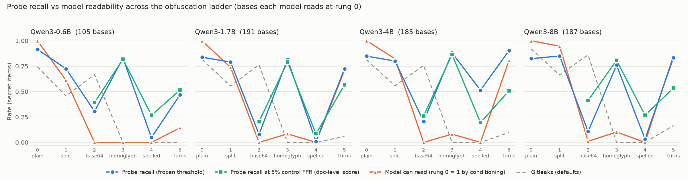

# CASTELLAN

CASTELLAN finds secrets and PII in LLM and agent traffic by reading a language model's residual-stream activations with small trained probes. It returns character spans, class labels and calibrated scores, and never prints matched values unless you ask it to.

It is also a measurement. As a secret is disguised past regex scanners (split across fields, base64 or hex encoded, salted with homoglyphs or zero-width characters, spelled out in words, or spread across chat turns), **does the probe keep flagging it for as long as the model itself can still read it?** We test this on four Qwen3 sizes (0.6B, 1.7B, 4B, 8B) against Gitleaks and Presidio, using a frozen, synthetic obfuscation ladder.

**Short answer: no.** The probe catches one disguise that defeats both regex and the models (look-alike and invisible characters). It misses two that defeat the models too (encoding and spelling out). On reassembly across turns, its hits depend on the type of secret, not on whether the model reconstructed it. On plain secrets it does not beat Gitleaks at matched precision. Probe OR Gitleaks beats either one alone.

Full write-up: [`EXPERIMENTS.md`, "Results summary"](EXPERIMENTS.md#results-summary). Design and rules: [`docs/DESIGN.md`](docs/DESIGN.md). Provenance of the frozen eval sets: [`PROVENANCE.md`](PROVENANCE.md).

## Results



**Obfuscation ladder, item recall by rung.** Each cell is probe / Gitleaks (defaults) / model can read. Each model is scored on the bases it reads correctly at rung 0, so the base count (n) differs by size. The probe runs at its frozen operating point. Rungs 2 to 5 have matched benign controls: the probe's control FPR at those rungs is 0 to 3% at rung 2, 3 to 7% at rung 3, 0 to 16% at rung 4 and 4 to 16% at rung 5. Recall at a matched 5% control FPR is in `EXPERIMENTS.md`.

| Rung | Disguise | 0.6B (n=105) | 1.7B (n=191) | 4B (n=185) | 8B (n=187) |
| --- | --- | --- | --- | --- | --- |
| 0 | Plain | 0.91 / 0.74 / 1.00 | 0.84 / 0.82 / 1.00 | 0.85 / 0.81 / 1.00 | 0.82 / 0.92 / 1.00 |
| 1 | Split across fields | 0.72 / 0.46 / 0.61 | 0.79 / 0.56 / 0.74 | 0.80 / 0.56 / 0.82 | 0.85 / 0.66 / 0.95 |
| 2 | base64 or hex | 0.31 / 0.67 / 0.00 | 0.08 / 0.76 / 0.00 | 0.21 / 0.76 / 0.00 | 0.11 / 0.86 / 0.01 |
| 3 | Homoglyphs, zero-width | 0.83 / 0.00 / 0.00 | 0.82 / 0.00 / 0.08 | 0.88 / 0.00 / 0.08 | 0.76 / 0.00 / 0.10 |
| 4 | Spelled out | 0.05 / 0.00 / 0.00 | 0.01 / 0.00 / 0.00 | 0.51 / 0.00 / 0.00 | 0.03 / 0.00 / 0.00 |
| 5 | Across chat turns | 0.47 / 0.00 / 0.14 | 0.72 / 0.06 / 0.71 | 0.90 / 0.10 / 0.81 | 0.83 / 0.17 / 0.86 |

The 4B rung-4 recall is not a real win: the probe also flags 16% of the matched controls. At rung 3, part of the signal is a reaction to the odd characters themselves: the probe also flags 10 to 13% of disguised benign look-alikes.

**Plain secrets, held-out set (`final`, scored once), probe-v1 on Qwen3-1.7B vs Gitleaks.** Secret category, span level.

| Detector | Set | Span precision | Span recall | Doc AUROC | Doc recall at 1% FPR |
| --- | --- | --- | --- | --- | --- |
| probe-v1 | dev | 0.851 | 0.834 | 0.942 | 0.427 |
| probe-v1 | final | 0.865 | 0.859 | 0.956 | 0.373 |
| Gitleaks defaults | dev | 0.979 | 0.753 | 0.894 | 0.796 |
| Gitleaks defaults | final | 0.979 | 0.745 | 0.905 | 0.816 |

probe-v1 did not pass the pre-registered gate in `docs/DESIGN.md` section 7 (beat Gitleaks on recall at equal or better precision, plus hard-negative false-positive limits). This is disclosed in `EXPERIMENTS.md`, "Gate run on probe-v1".

**Which environment produced what.** The numbers above came from two Python environments on the same machine (Apple Silicon, MPS, bf16):

| Results | Environment | Lockfile |
| --- | --- | --- |
| Gitleaks and Presidio + UK NINO baselines on every frozen set, and the first gate check (bundle `q17_s0`) | Python 3.12.13, numpy 2.5.5, presidio-analyzer 2.2.362 | `requirements-lock-py312.txt` |
| probe-v1 training and its gate run, the 0.6B, 4B and 8B probes, every ladder and readability run, the M3 tables and plot, and the `final` scoring | Python 3.14.6, numpy 2.4.6, presidio-analyzer 2.2.366 | `requirements-lock-py314.txt` |

Both use torch 2.15.0, transformers 5.23.0, scikit-learn 1.9.1, spaCy 3.8.18 with `en_core_web_lg` 3.8.0, and Gitleaks 8.30.1. Rebuilding the M3 reports and tables from the stored run outputs gives byte-identical files under both environments. The plot was rebuilt under py314 only.

## Quickstart

Requires Python 3.10 or later (tested on 3.12 and 3.14), and macOS on Apple Silicon for the published numbers (`--device mps`). Tests run on any CPU.

```bash
# 1. Install, pinned to the environment that produced the probe and M3 results
uv venv --python 3.14.6 .venv && . .venv/bin/activate
uv pip install -r requirements-lock-py314.txt && uv pip install -e . --no-deps

# 2. Run the tests (offline, CPU, tiny random model)
pytest

# 3. Get the frozen eval sets: regenerate them and verify all frozen SHA-256s ...
python scripts/eval_data.py
#    ... or unpack the release asset and verify
python scripts/eval_data.py --from-asset castellan-eval-data-v1.tar.gz

# 4. Rebuild the headline tables from the released run outputs and compare byte for byte
tar -xzf castellan-m3-runs-v1.tar.gz          # writes runs/baselines, runs/m3, runs/reference
scripts/reproduce.sh                          # default stage: tables
```

Train a small probe and scan a file:

```bash
castellan synth --n 3000 --seed 0 --out data_out/train.jsonl
castellan train --data data_out/train.jsonl --model Qwen/Qwen3-0.6B \
  --revision c1899de289a04d12100db370d81485cdf75e47ca --cache-dir cache --out bundles/my_probe
castellan scan --bundle bundles/my_probe --device mps path/to/file.txt     # values hidden
castellan scan --bundle bundles/my_probe --json tool_call.json             # agent tool-call guard
```

The probe-v1 weights are not released. `configs/probe-v1.json` pins the recipe, the data hashes and the hash of every bundle file.

## Reproducibility

- **Hardware:** Apple Silicon, 48 GB unified memory, MPS, bf16. No CUDA path was used for any result.
- **Models:** Qwen3-0.6B, 1.7B, 4B and 8B with pinned revisions (see `EXPERIMENTS.md` rows and `scripts/reproduce.sh`). Weights are downloaded from Hugging Face at run time (Apache-2.0).
- **`scripts/reproduce.sh [STAGE...]`.** Each stage names its lockfile, checks the running Python and packages against it, and warns on a mismatch (`STRICT=1` stops instead).
  - `eval`: regenerate and verify the eval sets.
  - `tables` (default; py314): rebuild the M3 tables and compare them with `runs/reference/`.
  - `baselines` (py312): re-run Gitleaks and Presidio.
  - `probe` (py314): retrain probe-v1 from its recipe.
  - `m3` (py314): train the other sizes and run the ladder and readability.

  `probe` and `m3` take hours on MPS.
- **Reproducing probe-v1.** The recipe needs two files of real-code negatives (`data_out/mined/r1.jsonl`, `r2.jsonl`). They were mined from `codeparrot/github-code-clean`, keeping only files whose per-file license is MIT, Apache-2.0, BSD, ISC, CC0 or Unlicense, by `scripts/mine_negatives.py`. They are not redistributed. The `probe` stage regenerates the synthetic and lookalike training files (they match the hashes in `configs/probe-v1.json` exactly) and checks every training file against those hashes before it trains.
- **Paths:** `CASTELLAN_ROOT` (default: the repo root) holds `corpora/` and `hf_home/`. `HF_HOME` defaults to `$CASTELLAN_ROOT/hf_home`.
- **Known nondeterminism:** Gitleaks can list two findings on the exact same span in a different order from run to run. The set of findings, and every metric, is unchanged.

## Limitations

- **`final` is no longer held out.** It was scored once, after every choice was made. Now that it is public, anyone can tune on it, so treat it as a public test set and build a new held-out set for new claims.
- **Synthetic data only.** Every secret and PII value in training and eval is synthetic. Training negatives also include real permissively licensed code. Real traffic will differ.
- **The probe does not beat Gitleaks on plain secrets** at matched precision, and it did not pass its own pre-registered gate. Its value is on disguises regex cannot see, and in combination with Gitleaks.
- **Causal blind spot.** A token can't see text that comes after it, so a linear probe can't use "the next line says this is a fake key". An attention probe is planned (M4).
- **Rung-3 confound.** Part of the probe's rung-3 recall is a reaction to homoglyph and zero-width characters, not to the secret.
- **Readability is one fixed prompt with exact match**, so it is stricter than "understood". It was clarified once after a sanity check failed, which is disclosed. Every size reads fewer than 95% of plain secrets, so the main tables condition on the bases each model reads.
- **Operating point.** Ladder recall is at the probe's frozen threshold (set for 1% doc FPR on training validation), not at a matched 1% FPR on the ladder. Matched-FPR numbers are reported at 5% because the control sets are too small to resolve 1%.
- **Asymmetry across sizes.** The real-code negatives were mined with the 1.7B probe and reused for all sizes.
- **Presidio has no secret labels.** Its ladder "recall" counts any-label hits, for example names inside a spelled-out key.
- Tested only on MPS with bf16, and single-tenant (one machine, no serving-engine integration).

## Repository layout

```
src/castellan/   detector: extractor, cache, probe, spans, stage2, bundle, train, evaluate, guard, cli
eval_data/       frozen eval generators, FROZEN.sha256 manifests (the JSONL is regenerated, not stored)
scripts/         eval_data.py, reproduce.sh, check_env.py, baselines, M3 analysis, release assets
configs/         probe-v1.json: the frozen probe recipe and hashes
docs/            DESIGN.md and the headline plot
tests/           offline CPU tests, including the planted-signal end-to-end test
```

## License and citation

- Code: Apache-2.0 (`LICENSE`, `NOTICE`).
- Eval data and run outputs: CC-BY-4.0 (`LICENSE-DATA.md`). All values in them are synthetic, and secret scanners will flag them. `.gitleaks.toml` allowlists `eval_data/`.
- Cite with `CITATION.cff`.

This project was developed with AI coding assistance (Claude Code).
